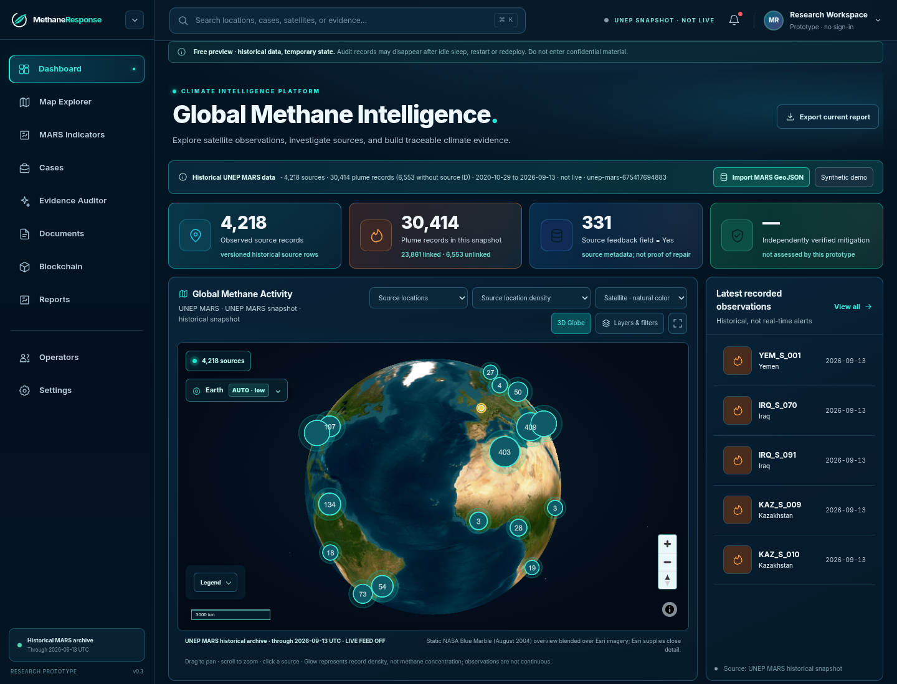
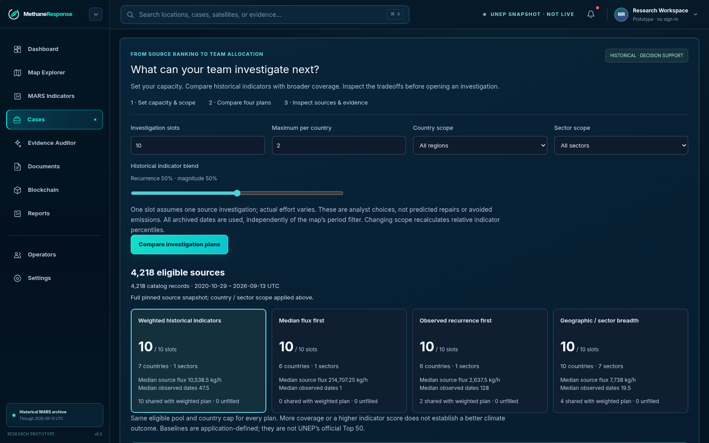
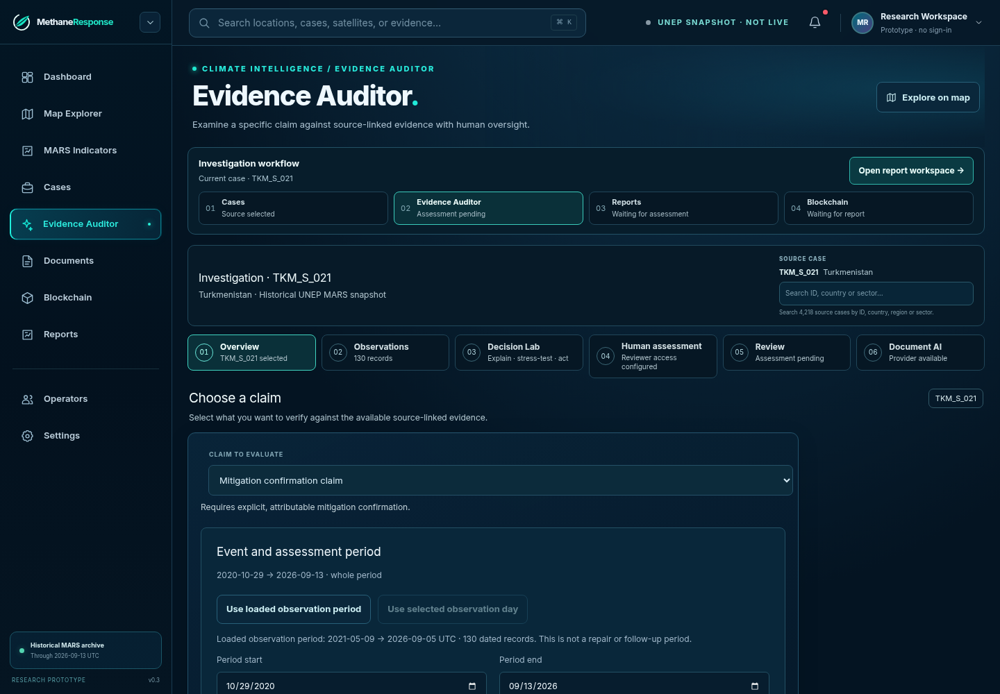
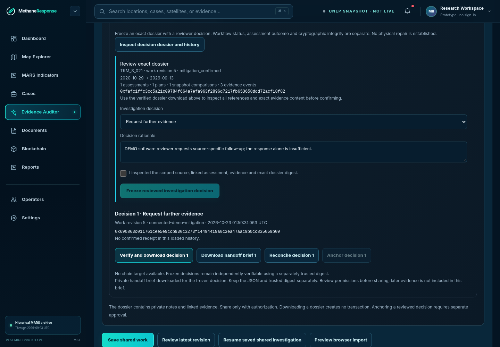
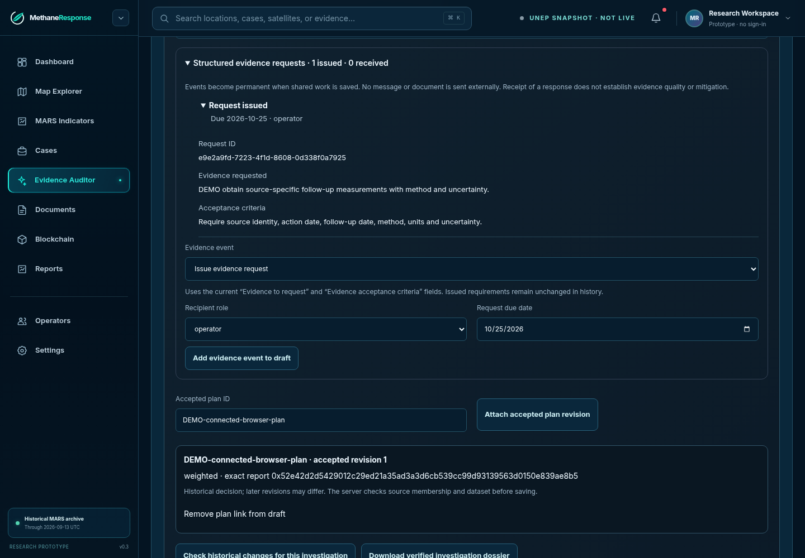
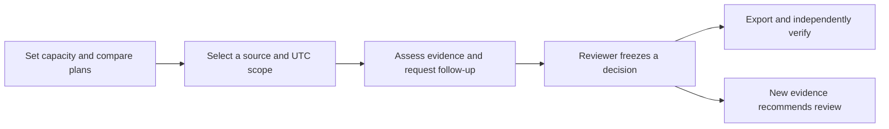
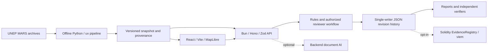

<p align="center">
  
</p>
<h1 align="center">MethaneResponse</h1>
<p align="center"><strong>One explainable investigation plan. One actionable evidence request. One verifiable decision.</strong></p>
<p align="center">
  Turn historical methane observations and scattered evidence into investigations your team can explain and review.
</p>
<p align="center">
  <a href="https://github.com/AndroLay/MethaneResponse/actions/workflows/ci.yml"></a>
  
  
  
  <a href="LICENSE"></a>
</p>
<p align="center">
  <a href="https://methaneresponse-preview.onrender.com/dashboard">Open preview</a> ·
  <a href="#quick-start">Run locally</a> ·
  <a href="docs/product/organization-walkthrough.md">Try an investigation</a> ·
  <a href="docs/demo/delivery-2026-10-22-final-v18/README.md">Demo video &amp; production evidence</a> ·
  <a href="docs/README.md">Documentation</a>
</p>

<a href="docs/assets/screenshots/dashboard.webp"></a>

*Actual public-preview browser capture, 21 October 2026. Basemap imagery provides geographic context, not methane measurement. All screenshot dates, sources and capture environments are recorded in the [screenshot manifest](docs/assets/screenshots/manifest.json).*

> **IEEE ClimateChain 2026 · Climate Data & Environmental Monitoring.** This is a working proof of concept. The public preview has temporary state, three curated baseline sources, and no private reviewer or blockchain writes. The full local workflow is demonstrated separately. [Preview scope](#choose-your-environment).

## Why MethaneResponse?

A team may have thousands of historical methane observations and capacity to investigate only ten sources. Selecting those sources is only the first decision. The team must also establish what was observed, which claims the evidence supports, what is missing, and whether a later response changes an earlier conclusion.

**UNEP MARS supplies methane observations and response context. MethaneResponse organizes the investigation that follows.** It preserves source identifiers and snapshot provenance while connecting priorities, scoped evidence, requests, reviewer decisions and revision history.

| Team's starting point | What the application produces |
|---|---|
| More sources than investigation slots | Capacity-constrained portfolios with selection and exclusion reasons |
| A claim and incomplete supporting material | A scoped assessment and explicit evidence gaps |
| An unresolved investigation | A request with recipient role, deadline and acceptance criteria |
| A reviewer determination | A frozen decision dossier, JSON export and readable Markdown handoff |
| A later response or changed snapshot | Reasons to revisit, while preserving the previous decision |
| A published or shared report | Integrity checks against a separately trusted digest and, when configured, a contract event |

These are demonstrated software outputs. Faster human work, successful field repairs and reduced emissions have not been established.

## Inside the application

Screenshots are actual application captures. Historical MARS metadata is real; working requests, responses and reviewer examples in the private workflow are visibly **DEMO software fixtures**. Select an image to inspect it at full size.

<table>
<tr>
<td width="50%" valign="top">
<h3>Plan within your capacity</h3>
<p>Compare strategies and inspect why a source was selected. Editing capacity from 10 to 20 creates a comparison; replacing the active queue requires explicit activation.</p>
<a href="docs/assets/screenshots/planner.webp"></a>
</td>
<td width="50%" valign="top">
<h3>Inspect the evidence</h3>
<p>Keep the source, claim, UTC scope, dated observations and coverage gaps together. Rules remain available without a model account.</p>
<a href="docs/assets/screenshots/auditor.webp"></a>
</td>
</tr>
<tr>
<td width="50%" valign="top">
<h3>Preserve a reviewable decision</h3>
<p>Freeze the exact dossier and rationale. Export the JSON and a readable handoff; retain the trusted digest separately.</p>
<a href="docs/assets/screenshots/decision.webp"></a>
</td>
<td width="50%" valign="top">
<h3>Make follow-up actionable</h3>
<p>Record the required material, recipient role, due date and acceptance criteria. Requests and later responses remain connected to the investigation.</p>
<a href="docs/assets/screenshots/investigation.webp"></a>
</td>
</tr>
</table>

## Plan → Investigate → Verify



**For analysts, NGO investigation teams, regulators and independent auditors.** The [organization walkthrough](docs/product/organization-walkthrough.md) gives a task, expected outputs, acceptance checks and recovery steps. It separates the anonymous preview from the private local workflow.

### What AI does

Optional backend document assessment compares a specific claim with authorized excerpts and returns supporting, contradictory or insufficient evidence. Exact-quotation checks and deterministic validation constrain the output; a reviewer retains responsibility for the decision. Secrets and model execution stay off the frontend.

The recorded **DeepSeek V4.1 Flash 1017** integration passed three project-authored DEMO scenarios through the real provider. That establishes integration on those examples, not independently measured accuracy. An earlier limited agent benchmark did not show an advantage over the rules baseline. [AI evidence and limitations](docs/evidence/deepseek-live-2026-10-21/README.md).

### What blockchain does

The existing Solidity `EvidenceRegistry` records opaque identifiers and cryptographic commitments to versioned results. The independent verifier checks the committed digest and transaction event when a chain target is configured. Local Anvil tests cover anchoring, revision history, edited-and-rehashed reports, and transaction recovery.

**Current chain evidence is Anvil local chain 31337.** No public Sepolia receipt is claimed. A contract commitment establishes integrity relative to that commitment; physical repairs, emissions reductions and independent reviewer identity require other evidence. [Same-take TKM export, trusted pin and receipt](docs/evidence/video-v17-2026-10-22/README.md).

## Quick start

Use the repository-pinned **Bun 1.4.2** from [.bun-version](.bun-version), plus Linux `flock` for the API's single-writer launcher. The baseline needs **no database, cloud account, AI key or funded wallet**. Internet access is needed for installation and external map imagery; a map fallback is available.

```bash
git clone https://github.com/AndroLay/MethaneResponse.git
cd MethaneResponse
bun install --frozen-lockfile
```

**Terminal 1 — API**

```bash
HOST=127.0.0.1 bun run dev:api
```

**Terminal 2 — web**

```bash
bun run dev:web
```

Open **http://localhost:5173/dashboard**. API readiness: **http://localhost:3001/api/health**.

1. Open **Cases** and choose `KAZ_S_159`.
2. Inspect an observation's original ID, UTC date, estimated flux and reported uncertainty.
3. Open **Evidence Auditor**, choose the mitigation claim and run the rules baseline.
4. Expect `insufficient_evidence` with the bundled material; inspect which evidence is missing.
5. Export JSON and inspect it in **Reports → Verification Center**.

An application audit export can also be checked with:

```bash
bun run verify:audit path/to/report.json --require-context
```

This checks the report and export context. Keep its trust limitations distinct from chain verification. [Full setup and troubleshooting](docs/development/local-setup.md).

### Reproduce the private workflow without credentials

After installing the Playwright Chromium runtime, run the isolated software demonstration:

```bash
bun run playwright install chromium
PLAYWRIGHT_OUTPUT_DIR=.playwright-cli/organization-demo bun run demo:workflow
```

It builds the web app, starts disposable local services, generates short-lived DEMO reviewer credentials and exercises **TKM_S_021 → request → assessment → frozen decision → later response**. No real provider, public transaction or operator contact is used. Services stop after the test. JSON decisions, a separately captured UI digest, a Markdown handoff and browser screenshots are retained in the named output directory.

This is reproducible software acceptance, not a human usability study. [Steps, outputs and prerequisites](docs/product/organization-walkthrough.md#repeatable-software-demonstration).

### Share a readable investigation handoff

In the configured private workspace, inspect a frozen decision and select **Download handoff brief**. The browser checks the decision against the digest from its loaded reviewer history before downloading Markdown. The handoff names the source, claim, UTC period, decision, required evidence, request deadlines and acceptance criteria. Unset fields remain explicitly missing.

For a downloaded decision and a pin obtained separately from a trusted source:

```bash
bun run export:investigation-brief path/to/decision.json \
  --expected-digest 0xYOUR_TRUSTED_SHA256 \
  --output path/to/new-handoff.md
```

The output is private working material; inspect and redact it before sharing. Keep the original JSON and pin. Markdown is a readable derivative, not a signed report, and the exporter does not perform blockchain verification or include later uncommitted evidence.

**Inspect an actual output:** [TKM_S_021 DEMO handoff](docs/evidence/organization-handoff-2026-10-23/organization-handoff.md) · [Matching JSON, pin and reproduction evidence](docs/evidence/organization-handoff-2026-10-23/README.md). These new files are separate from the older v18 video take and do not claim a chain receipt.

## Data you can trace

| Active snapshot | Contents |
|---|---|
| Identifier | `unep-mars-675417694883` |
| Historical period | 29 October 2020–13 September 2026 UTC |
| Source rows | **4,218** |
| Total plume rows | **30,414** |
| Plumes linked by source ID | **23,861**; another **6,553** lack a source ID |
| Estimates | Publisher-reported flux in **kg/h**, with reported uncertainty where available |

The dataset is historical and observations are discrete. Source locations and basemap imagery are not measured atmospheric concentration. Global map records do not automatically have the supporting documents of an audited case. Feedback is not proof of repair; missing later measurements are not proof of zero emissions.

Historical analysis and investigation rankings are explainable decision-support heuristics. They are not calibrated future-leak probabilities. New snapshot intake is staged and compared explicitly; existing investigations retain their original snapshot. [Provenance and license](data/real/README.md) · [Data and claims](docs/product/data-and-claims.md).

## Choose your environment

| Capability | Public preview | Full local prototype |
|---|---|---|
| Historical map and source exploration | Available | Available |
| Anonymous rules assessment | Three curated sources: KAZ, LBY and CAN | Bundled historical casebook |
| Document AI | Requires a separate access token | Optional backend provider and permission |
| Private review, requests and frozen decisions | Disabled | Requires scoped reviewer configuration; isolated DEMO available |
| Blockchain writes | Disabled | Explicit opt-in and operation authorization; Anvil tested |
| State | Temporary; may disappear after restart or deployment | Single-writer local files; retain and back up them |

The preview may need to wake after inactivity. The local video demonstrates the fuller local prototype. Do not enter confidential documents into the public preview. [Preview evidence](docs/evidence/render-preview-2026-10-21/README.md) · [Configuration](docs/development/configuration.md).

## Architecture



| Directory | Responsibility |
|---|---|
| [apps/web](apps/web/) | Explorer, cases, planner, audit workspace, reports and browser verification |
| [apps/api](apps/api/) | Validation, authorization, assessment, revision storage and chain coordination |
| [packages/shared](packages/shared/) | Schemas, deterministic policies, canonical hashing and portable brief rendering |
| [services/data-pipeline](services/data-pipeline/) | Offline ingestion, historical analysis and evaluation |
| [contracts](contracts/) | EvidenceRegistry and Foundry tests |
| [scripts](scripts/) | Independent verifiers, integration checks and release tools |

**Deployment boundary:** one writer, local files, process-local quotas. Existing limits include 500 work items and 100 revisions per work item. This is a small-team prototype, not demonstrated multi-tenant infrastructure. A global dataset does not establish concurrent-user scalability. [Architecture](docs/architecture/overview.md) · [Storage and recovery](docs/development/connected-investigations.md#storage-limits-and-rollback).

## Verification and honest limits

CI runs typechecks, API/web/verifier tests, production build and bundle budgets, Chromium workflows, Python pipeline tests and Foundry contract tests. Use the [CI history](https://github.com/AndroLay/MethaneResponse/actions) to check the exact revision; earlier passing records do not certify later changes.

```bash
bun run check
bun run test:api
bun run test:web
bun run test:verifier
bun run build:web
bun run check:web-bundle
bun run test:e2e
# Optional toolchains: Python/uv and Foundry
bun run test:data
bun run test:contracts
```

| Evidence | What it supports | Boundary |
|---|---|---|
| [Latest release checks](docs/evidence/release-sync-2026-10-23/README.md) | Recorded application, browser, pipeline and contract behavior | Revision-specific software checks |
| [Live-model smoke test](docs/evidence/deepseek-live-2026-10-21/README.md) | Provider transport, citations and bundles on three DEMO examples | No independently established model accuracy |
| [TKM chain replay](docs/evidence/video-v17-2026-10-22/README.md) | Matching export, pin and local receipt; tamper rejection | Local chain and software DEMO review |
| [r12 recovery audit](docs/evidence/r12-recovery-2026-10-21/README.md) | Scorer, runner and protocol diagnosis with focused regressions | Frozen completion remains **0/48**; no replacement 48-episode result |
| [v18 video evidence](docs/demo/delivery-2026-10-22-final-v18/README.md) | Local 4:57 MP4, technical audit and sampled visual checks | Full playback/listening and public upload remain separately unverified |

The r12 audit identified overlapping scorer false negatives and protocol/tool limitations. Its 0/48 score is the frozen scorer's result; it is not an estimate of application success in the field. The audit does not establish that all episodes passed. Human productivity, institutional adoption, physical repairs and emissions reductions remain unproven.

## Documentation and contributing

- **Start here:** [Organization walkthrough](docs/product/organization-walkthrough.md) · [User workflow](docs/product/user-workflow.md) · [Glossary](docs/glossary.md)
- **Develop:** [Local setup](docs/development/local-setup.md) · [API reference](docs/architecture/api-reference.md) · [Contribution guide](docs/development/contributing.md)
- **Review evidence:** [Evidence index](docs/evidence/README.md) · [Current implementation status](docs/release/current-implementation-status.md)
- **Prepare submission:** [Devpost package](docs/release/devpost-submission/README.md) · [Event requirements](docs/release/event-requirements.md)
- **Navigate:** [Documentation home](docs/README.md) · [Repository map](docs/repository-map.md)

When contributing, preserve original source IDs, dataset licenses and old audit compatibility. Include focused tests for behavior changes. Never put secrets in the frontend, treat generated claims as measurements, or rewrite frozen evaluation evidence.

## License and attribution

Original software and project-authored documentation are **MIT**. Historical UNEP MARS data has separate **CC BY-NC-SA 4.0** terms. Reports, imagery and tiles retain their respective rights; no UNEP endorsement is asserted. See [LICENSE](LICENSE), [NOTICE](NOTICE), and [data attribution](data/real/README.md).
