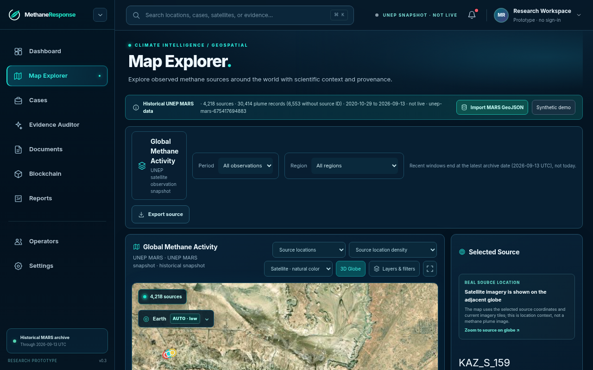
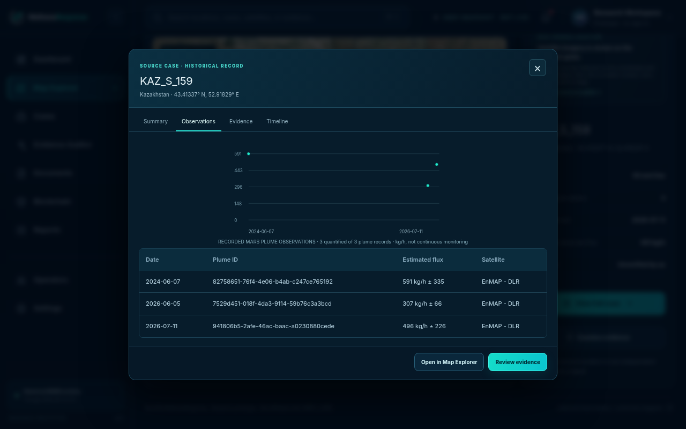
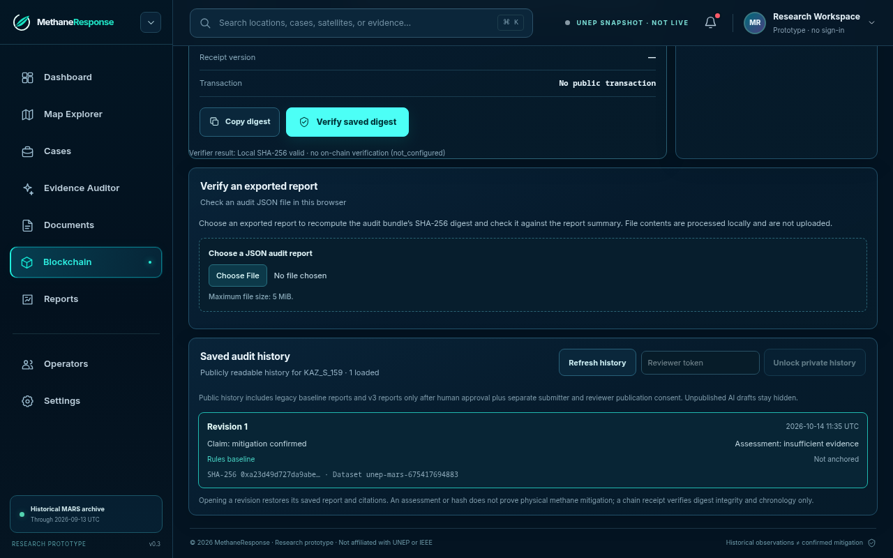
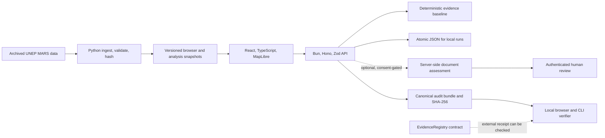

# MethaneResponse

**Independent evidence audits for historical methane observations.**

MethaneResponse helps researchers, auditors, and public-interest analysts inspect whether a claim about a methane source or its mitigation is supported by traceable evidence. It brings historical UNEP MARS records, source-linked documents, deterministic claim checks, human review, and verifiable audit history into one workflow.

[](https://react.dev/)
[](https://www.typescriptlang.org/)
[](https://maplibre.org/)
[](https://bun.sh/)
[](https://hono.dev/)
[](https://www.python.org/)
[](https://soliditylang.org/)
[](LICENSE)

**IEEE ClimateChain 2026 · Climate Data & Environmental Monitoring · Local MVP / proof of concept**

> The web app and Bun/Hono API run locally with real historical data and a working audit flow. MARS snapshots and audit history use versioned local files; database services and adapters are outside the prototype scope. AI and Sepolia remain optional and are not live-configured in this workspace.

[Product workflow](docs/product/user-workflow.md) · [Quick start](#quick-start) · [Architecture](#architecture) · [Evidence and limits](#what-is-implemented) · [Verification](#verification) · [Documentation map](docs/README.md) · [Competition notes](docs/release/event-requirements.md)

## Why MethaneResponse

UNEP's Methane Alert and Response System (MARS) already detects and reports major methane sources and tracks response metadata. MethaneResponse does not recreate that detection service. It addresses the next question: **can another person inspect the evidence behind a claim about a source, a response, or mitigation?**

Satellite observations can support a detection claim. They do not, by themselves, prove that an operator received a notification or that equipment was repaired. MethaneResponse keeps those distinctions visible and returns *insufficient evidence* when the records do not support a stronger conclusion.

## What users can do

### Explore historical sources

Browse the versioned MARS snapshot on a MapLibre map, filter source records, inspect dated plume observations, and review the data provenance. The map is a historical data view, not a live methane sensor or a concentration surface.

### Prioritize what to investigate

Review recurrence, temporal patterns, anomaly screens, and an explainable investigation-priority heuristic. The recurrence analysis estimates another linked MARS archive record; it is not a calibrated probability of future leakage or a measurement of future emissions.

### Audit a specific claim

Run a deterministic evidence-coverage baseline against one typed claim. Each finding carries its source, snapshot, and available citation data. Missing follow-up observations are not treated as zero emissions, and `feedback` metadata alone never confirms repair.

### Review documents with safeguards

Import a hashed PDF/TXT excerpt manifest and, when a server-side provider is configured, request a document-grounded assessment. Exact quotations are validated against submitted excerpts. AI remains optional, can abstain, and is a suggestion for a separate authorized human review—not proof of physical mitigation.

### Preserve and verify audit history

Save immutable audit revisions, export a versioned JSON report, and verify its canonical SHA-256 locally. The Solidity registry and receipt verifier remain in the repository, but API anchoring and reconciliation are disabled with the local file store. A chain receipt, when independently supplied and verified, proves integrity and version chronology, not physical truth.

## Browser evidence

These are real Chromium captures from an isolated local UAT on 14 October 2026, using the historical MARS snapshot. They document observed product behavior; they are not generated mockups or evidence of a cloud deployment, live AI, or on-chain transaction.

<table>
  <tr>
    <td align="center" valign="top" width="33%"><strong>Explore a source</strong><br><a href="docs/evidence/live-local-uat-2026-10-14/01-map-explorer-kaz-s-159.png"></a><p>Historical source marker, snapshot context, and location imagery.</p></td>
    <td align="center" valign="top" width="33%"><strong>Inspect observations</strong><br><a href="docs/evidence/live-local-uat-2026-10-14/03-case-observation-history.png"></a><p>Dated overpasses with reported flux and uncertainty, not a continuous series.</p></td>
    <td align="center" valign="top" width="33%"><strong>Verify an audit digest</strong><br><a href="docs/evidence/live-local-uat-2026-10-14/05-integrity-after-api-restart.png"></a><p>Local audit survived an API process restart using the same file store.</p></td>
  </tr>
</table>

The full procedures, screenshots, hashes, and exact test conditions are in [local browser UAT evidence](docs/evidence/live-local-uat-2026-10-14/README.md) and [the deterministic audit demo record](docs/evidence/demo-workflow-2026-10-14/README.md). The current working tree may include UI changes made after these dated captures.

## Quick start

### Requirements

- Bun **1.4.2** (pinned in `.bun-version`) for the web app and API.
- Python 3.11+ and `uv` for data-pipeline commands.
- Foundry for Solidity contract tests.

The bundled historical data snapshot is sufficient to run the web app and API; a new download or cloud account is not needed for the basic workflow.

```bash
git clone https://github.com/AndroLay/MethaneResponse.git
cd MethaneResponse
bun install --frozen-lockfile
```

Start the API in one terminal:

```bash
bun run dev:api
```

Start the web app in another terminal:

```bash
bun run dev:web
```

Open <http://localhost:5173>. The web app proxies `/api` to <http://localhost:3001>. Check the API state at <http://localhost:3001/api/health>.

No `.env` file is required for the local baseline flow. If you want to configure local options, copy `.env.example` to `apps/api/.env` only when that file does not already exist. Secrets belong in the API environment; never put them in `apps/web` or a `VITE_*` variable.

### Follow a real-source demo path

1. Open [Map Explorer for `KAZ_S_159`](http://localhost:5173/dashboard/map?sourceId=KAZ_S_159).
2. Inspect its source metadata, dated observations, reported flux, uncertainty, and snapshot provenance.
3. Choose **Review evidence** and run the deterministic baseline for a mitigation claim. With the bundled records, the correct result is `insufficient_evidence`.
4. Export the audit JSON and verify its digest in the Verification Center or with `bun run verify:audit <report.json>`.

This flow uses a real historical source and a working local API. It does not call an AI provider, submit a report to blockchain, or establish whether a physical repair occurred.

## What is implemented

| Capability | Local status | What the evidence establishes |
|---|---|---|
| Historical MARS explorer and case table | Available | Browser snapshot, provenance, source/plume records, filters, and dated observation details |
| Hono API and deterministic audit baseline | Available | API routes, typed claims, provenance-linked results, and abstention for unsupported claims |
| Audit history | Available locally | Atomic JSON persistence and survival across an API process restart when the same file remains available |
| Document-grounded AI path | Optional; provider not configured | Source code and mock-provider browser tests exist; no live provider quality or independent AI score is claimed |
| Human review | Conditional | Authenticated, scoped reviewer flow exists; identity and a real reviewer session have not been validated in a deployed service |
| Audit digest verification | Available locally | Canonical bundle digest can be checked locally; changing the bundle is detected |
| Blockchain integrity | Local digest verification available | The contract and verifier remain in the repo; API anchoring/reconciliation is disabled with the local file store, and no live transaction exists |
| User or climate impact | Not established | No user pilot, measured time savings, verified repair outcome, or emissions reduction attributable to this product |

Audit history is written to an atomic local JSON file. It supports the single-process prototype workflow; a hosted preview may lose that file when its ephemeral filesystem is reset. See the [prototype scope decision](docs/architecture/decisions/2026-10-15-local-prototype-no-database.md).

## Architecture



| Layer | Technology | Responsibility |
|---|---|---|
| Web | React, Vite, TypeScript, MapLibre | Historical data exploration, case review, audit workflow, report verifier |
| API | Bun, Hono, Zod | Source/case APIs, deterministic claims, audit revisions, optional review and chain endpoints |
| Local storage | Atomic JSON files | Versioned MARS snapshots and single-process audit history for the prototype |
| Data pipeline | Python, `uv` | Reproducible import, normalization, source-history analysis, and evaluation |
| Contract | Solidity, Foundry, viem | Evidence hash registry and receipt verification |

Database services, migrations, and cloud persistence are intentionally excluded from the current prototype scope. No Supabase project or database setup is part of the workflow.

## Data integrity and scientific limits

The bundled active browser snapshot is `unep-mars-675417694883`, retrieved from the UNEP archive on 14 October 2026 and checked against the upstream archive metadata on 15 October. It contains **4,218 source rows and 30,414 plume rows**, with observation dates from **29 October 2020 through 13 September 2026 UTC**. The snapshot is historical and does not refresh itself.

- Original source/plume identifiers, observation dates, coordinates, reported units, uncertainty fields, and archive provenance are retained where published.
- Unlinked plume records remain unresolved; missing flux and missing later observations are not converted to zero.
- Source `notified` and `feedback` fields are publisher metadata. They do not prove receipt, repair, or reduced emissions.
- Map imagery provides geographic context; it is not the satellite methane observation for a given overpass.
- The active four-source audit casebook is a curated excerpt, not a complete independent audit of four facilities. External report links are metadata only unless exact source text and rights are separately supplied.
- The dataset is distributed under **CC BY-NC-SA 4.0**. Some linked reports have separate terms; map tiles, bundled interface assets, and third-party material have separate rights. Read [`NOTICE`](NOTICE) and [snapshot provenance](data/real/README.md).

## Optional services

| Service | Configuration | Safeguard |
|---|---|---|
| AI provider | `AI_BASE_URL`, `AI_API_KEY`, and `AI_MODEL` on the API | Never expose credentials to the browser. Requires rights-cleared excerpts and explicit submission consent. Provider calls may incur cost. |
| Reviewer authentication | `REVIEWER_AUTH_SECRET` and scoped reviewer credentials | Keep review/read/anchor scopes separate and short-lived. |
| Sepolia receipt verification | RPC URL and registry address | Report anchoring/reconciliation is disabled in this file-store prototype; no transaction is sent. |

See [`.env.example`](.env.example) for optional local settings and [deployment documentation](docs/release/deployment.md) for the prototype's file-storage behavior.

## Verification

| Command | Checks |
|---|---|
| `bun run check` | API, web, and E2E TypeScript checks |
| `bun run test:api` | Hono routes, baseline, local file persistence, review, and verifier behavior |
| `bun run test:web` | Browser-facing component and workflow logic |
| `bun run test:verifier` | Report integrity, map-performance helpers, and deployment/configuration guards |
| `bun run test:e2e` | Local browser journeys with isolated services; AI uses a deterministic mock provider in its test workflow |
| `bun run test:data` | Python ingestion, intelligence, and evaluation tests; requires `uv` |
| `bun run test:contracts` | Foundry tests for the EvidenceRegistry contract |
| `bun run build:web` | Production web bundle |

The dated [15 October execution checkpoint](docs/history/execution-checkpoint-2026-10-15.md) and [evidence index](docs/evidence/README.md) record exact commands, revisions, results, and limitations. A passing local suite is not evidence of live provider quality, cloud durability, Sepolia activity, user benefit, or emissions impact.

## Repository map

| Path | Responsibility |
|---|---|
| `apps/web` | React workspaces, MapLibre explorer, case and audit UI |
| `apps/api` | Hono API, evidence baseline, audit store, optional AI/reviewer/chain paths |
| `packages/shared` | Shared Zod schemas and clearly labeled synthetic fixtures |
| `services/data-pipeline` | UNEP MARS import, historical analysis, and evaluation tools |
| `data/real` | Attributed real-data casebook and snapshot provenance/history |
| `data/fixtures` | Synthetic fixtures, visibly labeled for demo/test use |
| `contracts` | Solidity EvidenceRegistry and Foundry tests |
| `scripts` | Local verification, report verification, document preparation, and quality guards |
| `docs` | Product workflow, architecture, deployment, research, and dated evidence |

## Documentation

- [Documentation index](docs/README.md) — current entry points, evidence, research, and historical notes.
- [User workflow](docs/product/user-workflow.md) — how to run each workspace and what each result means.
- [Architecture](docs/architecture/overview.md) — service boundaries and end-to-end flows.
- [Data and claims](docs/product/data-and-claims.md) — provenance, dataset versioning, and scientific interpretation limits.
- [Prototype scope decision](docs/architecture/decisions/2026-10-15-local-prototype-no-database.md) — local MARS snapshots and audit files; no database implementation.
- [Deployment](docs/release/deployment.md) — prototype file persistence and hosted-preview behavior.
- [Research index](docs/research/README.md) · [Verification evidence index](docs/evidence/README.md) · [Demo materials index](docs/demo/README.md)

## IEEE ClimateChain 2026

MethaneResponse targets **Climate Data & Environmental Monitoring**: a traceable workflow for examining environmental observations and claims. The published Devpost overview asks for a project description, a 3–5 minute demo video, a public code repository, and a prototype/demo; it does not list a cloud database as a submission requirement. See the [official event page](https://ieee-climatechain-hack.devpost.com/) and [event notes](docs/release/event-requirements.md) for eligibility and schedule caveats.

The project does not claim to reduce methane directly. Its intended contribution is better access to source history, clearer distinction between reported response and documented mitigation, and audit records whose integrity can be independently checked.

## License and attribution

Original project software and project-authored documentation are MIT licensed. That license does not grant rights to UNEP MARS data, linked reports, map imagery, tiles, or third-party assets. See [`LICENSE`](LICENSE), [`NOTICE`](NOTICE), and [`data/real/README.md`](data/real/README.md) before redistribution or external processing.
