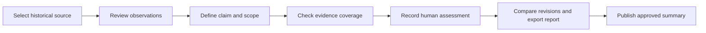
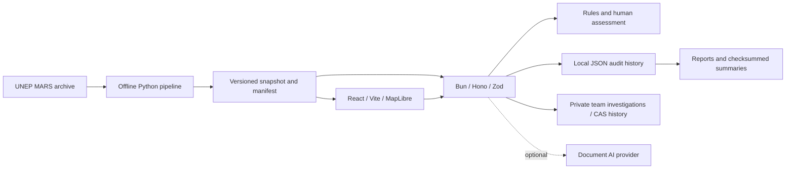

# MethaneResponse

**Select methane investigations, trace evidence, and account for decisions.**

MethaneResponse helps teams prioritize methane sources based on investigation capacity, check claims against historical UNEP MARS data and documents, and record evidence requests and reviewer decisions. When evidence changes, the system identifies which decisions may need review; versioned reports can be checked independently for integrity.

**Status:** Local proof of concept for IEEE ClimateChain 2026. The web app and API use a historical snapshot and local JSON files. AI is optional. Blockchain writes through the API are available with server-side opt-in and durable intents. Recovery has been tested on local Anvil; no public Sepolia receipt is available. See [implementation status](docs/release/current-implementation-status.md) for capabilities and the latest evidence.

[P5/P6 agent-scoped work is complete](docs/evidence/p5-p6-agent-completion-2026-10-18/README.md): two agents completed 48 manual/app tasks across six repeated sessions; two agent contexts assessed 72 test claims across 12 sources; CLI fixes were made; and 708 local tests passed. The results did not show an AI benefit over rules for this challenge. A human pilot and an independent provider benchmark remain outstanding; P4 is awaiting review as directed by the user.

**Public preview:** [Open MethaneResponse](https://methaneresponse-preview.onrender.com/dashboard).
Render Free uses ephemeral state. The DeepSeek model is enabled in the backend,
and assessments require a separate token. Human review and blockchain writes are
disabled in the preview. See [deployment evidence and limitations](docs/evidence/render-preview-2026-10-21/README.md).

**Video and proof — v18, 23 October:** the [v18 video package](docs/demo/delivery-2026-10-22-final-v18/README.md)
contains a local MP4 (**4:57, 1080p/25fps**). Its story is **Plan → Investigate → Verify**,
ending with the connection between investigation, potential field action, and outcome measurement.
[Proof take8 TKM_S_021](docs/evidence/video-v17-2026-10-22/README.md) pairs the
export with a DEMO reviewer pin and the **local Anvil 31337** receipt used in v18.
The DeepSeek example **KAZ_S_159 remains separate**. There is no evidence of repair,
emissions reduction, or measured human productivity. The [active submission package](docs/release/devpost-submission/README.md)
links the fields, judges' guide, public-access status, and v18 ZIP. Local files do
not prove a GitHub push, a current deployment, a video upload, or a submission.

**Latest agent evaluation:** [frozen r12](docs/evidence/agent-practical-usefulness-2026-10-21-r12/findings.md)
records **0/48 task completion according to the frozen scorer**, although 12 deterministic
gates passed. This does not establish Practical Usefulness or human productivity;
the earlier results above do not supersede r12.

**Release sync — 23 October:** [latest checks and preview operations](docs/evidence/release-sync-2026-10-23/README.md)
separates the local gate, CI for the exact commit, the Render deployment, and the
local video. The v18 production source and take8 proof are retained; public status
is checked separately.

## Understand the repository

**Live DeepSeek — 21 October:** the `deepseek-v4.1-flash-1017` model through
ExperientialLabs replaced the Luna plan. Three DEMO document scenarios passed
through the real provider with exact citations and bundle hashes; this was an
integration smoke test, not an independent accuracy benchmark. [Private configuration](docs/development/deepseek-integration.md)
· [Evidence and limitations](docs/evidence/deepseek-live-2026-10-21/README.md).

**P2 delivery — 20 October:** related claim/evidence candidate checks in private investigations, reviewer interpretations saved to history, a CLI verifier, and an opt-in snapshot downloader and intake. The 20 October UNEP release was downloaded and compared in staging; the active snapshot was not replaced. [Guide and limitations](docs/development/evidence-overlap-and-snapshot-intake.md) · [Latest evidence](docs/evidence/p2-delivery-2026-10-20/README.md).

**Connected Investigations — 20 October:** link allocation approvals, append-only evidence requests/responses, scoped assessments, and reviewer decisions that freeze an exact dossier. The verifier checks a separately supplied digest and, when configured, a contract receipt; new evidence can recommend a review without rewriting an earlier decision. The system remains database-free. [Workflow and recovery](docs/development/connected-investigations.md) · [Local evidence](docs/evidence/connected-investigations-2026-10-20/README.md).

**Snapshot Change Watch — 20 October:** compare two complete historical releases using their original source/plume IDs. Find changes that affect the selected plan, inspect before/after values, then continue to the evidence or map. In the bundled inputs, there were **7 new sources, 95 additional plume records (13 backfills), and 3 changed records**; three sources in the default allocation require record review. The verifier reruns the diff from both original inputs, including when a report is edited and its hash recalculated. This compares historical archives; it is not a live feed or evidence of a new leak. [Guide](docs/product/user-workflow.md#review-changes-between-two-historical-snapshots) · [Evidence and replay](docs/evidence/snapshot-change-watch-2026-10-20/README.md).

**Investigation Operations — 20 October:** activate a plan to show the **queue and map rings with matching IDs**; compare capacity from 10→20 without silently replacing the active selection. Import an earlier plan with a trusted digest, then review parameter or snapshot-summary changes. An authorized reviewer can save versioned accept/defer/reject decisions and export the history for the CLI verifier. The system remains database-free; a plan decision is not mitigation confirmation or a blockchain receipt. [Guide](docs/product/user-workflow.md#operate-and-review-a-plan) · [Evidence](docs/evidence/investigation-operations-2026-10-20/README.md).

**Investigation Capacity Planner — 19 October:** in **Cases → Plan investigation capacity**, set team slots and per-country limits, then compare four portfolios against the same snapshot. Review selection/exclusion reasons and sensitivity to assumptions; open a case, map, or Evidence Auditor with the same source ID. Export a versioned replay file. This allocates investigation capacity; it does not estimate repairs or avoidable emissions. [Method and scope](docs/plans/2026-10-19-investigation-planner.md).

**19 October increment — [Evidence Decision Lab](docs/evidence/decision-lab-2026-10-19/README.md):** explain each reference's eligibility, see how a decision changes when a reference is removed, then export an evidence request with acceptance checks. Five separate DEMO challenges show complete, insufficient, contrary, and conflicting results. A local chain test also rejected a report that had been edited **and had its checksum recalculated** because it no longer matched the contract commitment. This remains a metadata prototype, not repair certification.

**Additional feature — [Observation Claim Cross-Check](docs/evidence/observation-crosscheck-2026-10-19/README.md):** check statements about whether detection records exist or a flux-estimate threshold was met during a given period. Results identify contrary plume IDs, original dates, values, and SD, with a dot plot and draft follow-up. A scan of 4,218 sources/23,861 related records matched a separate Python implementation on the same inputs. The statement is an analyst scenario, not an allegation against an operator; this result is neither repair confirmation nor an independent scientific benchmark.

| Need | Read |
|---|---|
| Understand the repository in order | [Documentation index](docs/README.md) |
| Find folders and files to change | [Repository map](docs/repository-map.md) |
| Understand components and service relationships | [Architecture](docs/architecture/overview.md) |
| Follow the user workflow | [User workflow](docs/product/user-workflow.md) |
| Run the app and configure options | [Local setup](docs/development/local-setup.md) · [Configuration](docs/development/configuration.md) |
| Look up terminology | [Glossary](docs/glossary.md) |

## Problem and product workflow

Satellite detections can support a claim that a methane observation exists. Claims about notification receipt, operator action, and mitigation require different evidence. MethaneResponse provides a workflow for examining those distinctions.



Users can:

- Explore sources and plumes in **Map Explorer**, **Cases**, and **MARS Indicators**.
- Select investigation priorities using historical summaries and explainable rules.
- Run the rules baseline for detection, notification, or mitigation claims.
- Inspect decision dependencies in **Decision Lab**, review why references were excluded, and prepare replayable evidence requests.
- Find exact contrary records through **Decision Lab → Observation cross-check**, without treating the absence of records as zero emissions.
- Save private, AI-free human assessments with references, rationale, scope, and follow-up evidence requests.
- Continue investigations through browser notes or the [team workspace](docs/development/shared-casework.md), with assignees, due dates, revision conflicts, history, and per-tab draft recovery.
- Optionally check publisher-reference origin/digests, reviewer authorization status, and declared conflicts.
- Check JSON report checksums and approved public summaries. Markdown briefs can be read or imported into documents/Notion.

Document AI is available as an optional source-level path. Model output requires citation checks and human review; external model quality has not been measured independently.

## Quick start

Use **Bun 1.4.2** as specified in [.bun-version](.bun-version). The bundled snapshot is sufficient for the basic workflow; Python/`uv` is required for the pipeline, and Foundry for the contracts.

```bash
bun install --frozen-lockfile
```

Terminal 1:

```bash
bun run dev:api
```

Terminal 2:

```bash
bun run dev:web
```

Open <http://localhost:5173>. Vite proxies `/api` to port `3001`; API health is available at <http://localhost:3001/api/health>. The local baseline does not require `.env`. See [local setup](docs/development/local-setup.md) for the full guide.

To try it, open [source KAZ_S_159](http://localhost:5173/dashboard/map?sourceId=KAZ_S_159), review its observations, then run the rules baseline for a mitigation claim in Evidence Auditor. With the bundled evidence, the result is `insufficient_evidence`. Export JSON, then verify it in Verification Center or run:

```bash
bun run verify:audit path/to/report.json --require-context
```

`--require-context` requires an export-context checksum. For a legacy raw audit without an export checksum, omit the flag; the CLI reports this context limitation. The checksum is unsigned and does not authenticate the issuer or physical facts.

## Architecture



| Folder | Responsibility |
|---|---|
| [apps/web](apps/web/) | Interface, map, investigations, reports, and browser verifier |
| [apps/api](apps/api/) | Validation, baseline, assessment/review, privacy, and audit files |
| [packages/shared](packages/shared/) | Schemas, types, evidence-coverage rules, and DEMO fixtures |
| [services/data-pipeline](services/data-pipeline/) | Offline import, normalization, analysis, and evaluation |
| [data](data/) | Provenance, archives, derived data, fixtures, and local state |
| [contracts](contracts/) | Solidity EvidenceRegistry and Foundry tests |
| [scripts](scripts/) · [e2e](e2e/) | Verification tools, evidence preparation, and browser workflows |
| [docs](docs/README.md) | Current guides, decisions, research, and dated evidence |

The API runs as a single process with atomic audit files and separate team casework files. The launcher requires Linux `flock`; backup/restore uses the same lock. [ADR P1](docs/architecture/decisions/2026-10-17-shared-casework-single-writer.md) records the local collaboration limits. PostgreSQL, PostGIS, Supabase, and database migrations are out of scope under the [architecture decision](docs/architecture/decisions/2026-10-15-local-prototype-no-database.md).

## Data and interpretation limits

The active snapshot `unep-mars-675417694883` contains **4,218 source rows and 30,414 plume rows**, with observations from **29 October 2020–13 September 2026 UTC**. The data was downloaded on 14 October 2026; the latest recorded upstream metadata check is dated 15 October. The four-source casebook is a subset with reference context. Synthetic fixtures remain labeled **DEMO**. See [provenance](data/real/README.md) and the [data guide](docs/product/data-and-claims.md).

- The snapshot is a historical archive; it does not update automatically.
- `notified` and `feedback` are publisher metadata. Neither proves receipt, repair, or emissions reduction.
- The absence of later observations does not mean zero emissions. Recurrence estimates concern the next MARS record, not future physical leaks.
- A human assessment is a recorded reviewer decision. URL/digest checks and the reviewer directory have [their own trust limits](docs/product/trust-and-transparency.md).
- Checksums detect content changes. A blockchain receipt proves an integrity commitment and chronology; neither establishes physical truth.
- Browser notes are not automatically shared or backed up. The team workspace uses one authorized API process with history; temporary hosting filesystems may disappear.

## Verification

Commands, scope, and prerequisites are documented in the [testing guide](docs/testing/README.md). Choose `bun run check`, `bun run test:api`, and `bun run test:web` according to the change. Use `bun run test:e2e` for isolated browser workflows and `bun run check:all` for the cross-subsystem local gate.

[P1 evidence from 17 October](docs/evidence/shared-casework-2026-10-17/README.md) records the latest development checks. Dated evidence is tied to the files/revision present when the checks ran. The run covered two-session conflicts, crash/restart, backup/restore, and access regressions; remote limitations are stated separately.

## Competition, demo, and license

[IEEE ClimateChain notes](docs/release/event-requirements.md) record requirements and items to confirm with the organizers. [Demo materials](docs/demo/README.md) document production and local evidence; the app does not automatically upload a video or submit an entry.

Original software and project-authored documentation are licensed under MIT. UNEP MARS data uses **CC BY-NC-SA 4.0**; linked reports, imagery, tiles, and third-party assets have their own terms. Read [LICENSE](LICENSE), [NOTICE](NOTICE), and the [data attribution](data/real/README.md) before redistributing or processing them through an external service.
