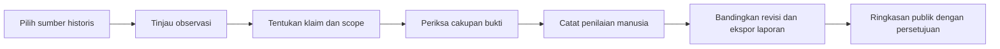
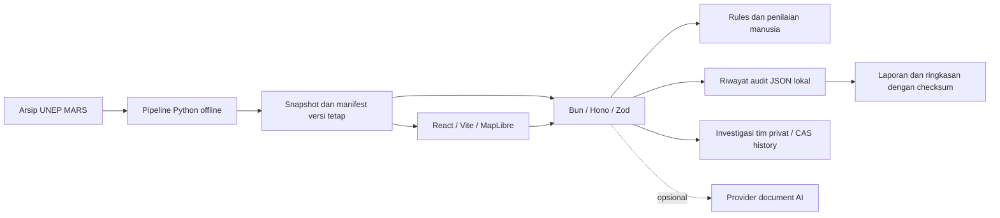

# MethaneResponse

**Menelusuri bukti di balik klaim tentang sumber metana, respons, dan mitigasi.**

MethaneResponse membantu peneliti, auditor, dan analis memeriksa data historis UNEP MARS, membatasi klaim pada kejadian atau periode tertentu, mencatat penilaian, lalu membagikan hasil dengan batas bukti yang jelas.

**Status:** proof of concept lokal untuk IEEE ClimateChain 2026. Web dan API memakai snapshot historis serta file JSON lokal. AI bersifat opsional. Write blockchain melalui API tersedia dengan opt-in server dan intent durabel. Pemulihan sudah diuji pada Anvil lokal; receipt Sepolia publik belum tersedia. Rincian kemampuan dan bukti terakhir ada di [status implementasi](docs/release/current-implementation-status.md).

[P5/P6 melalui agent selesai](docs/evidence/p5-p6-agent-completion-2026-10-18/README.md): 48 tugas manual/app oleh dua agent dalam enam sesi berulang, 72 klaim test/12 sumber dinilai dua konteks agent, perbaikan CLI serta 708 tes lokal lulus. Hasil tidak menunjukkan manfaat AI dibanding rules pada challenge ini. Pilot manusia dan benchmark provider independen belum terpenuhi; P4 menunggu review sesuai arahan pengguna.

## Mulai memahami repo

| Kebutuhan | Baca |
|---|---|
| Memahami seluruh repo secara berurutan | [Pusat dokumentasi](docs/README.md) |
| Menemukan folder dan file yang perlu diubah | [Peta repository](docs/repository-map.md) |
| Memahami komponen dan hubungan antarlayanan | [Arsitektur](docs/architecture/overview.md) |
| Mengikuti perjalanan pengguna | [Alur penggunaan](docs/product/user-workflow.md) |
| Menjalankan aplikasi dan mengatur opsi | [Setup lokal](docs/development/local-setup.md) · [Konfigurasi](docs/development/configuration.md) |
| Memahami istilah | [Glosarium](docs/glossary.md) |

## Masalah dan alur produk

Deteksi satelit dapat mendukung klaim adanya observasi metana. Pemeriksaan penerimaan notifikasi, tindakan operator, dan mitigasi membutuhkan bukti yang berbeda. MethaneResponse menyediakan alur untuk memeriksa perbedaan tersebut.



Pengguna dapat:

- Menjelajahi sumber dan plume di **Map Explorer**, **Cases**, serta **MARS Indicators**.
- Memilih prioritas investigasi dari ringkasan historis dan aturan yang dapat dijelaskan.
- Menjalankan rules baseline untuk klaim deteksi, notifikasi, atau mitigasi.
- Menyimpan penilaian manusia privat tanpa AI, dengan referensi, alasan, scope, dan permintaan bukti lanjutan.
- Melanjutkan beberapa investigasi melalui catatan browser atau [workspace tim](docs/development/shared-casework.md): assignee, due date, konflik revisi, riwayat serta pemulihan draft per tab.
- Memeriksa asal/digest referensi penerbit secara opsional, status otorisasi reviewer, serta konflik yang dideklarasikan.
- Memeriksa checksum laporan JSON dan ringkasan publik yang telah disetujui. Markdown brief tersedia untuk dibaca atau diimpor ke dokumen/Notion.

Document AI tersedia sebagai jalur opsional pada tingkat sumber. Hasil model memerlukan pemeriksaan kutipan dan peninjauan manusia; kualitas model eksternal belum diukur secara independen.

## Quick start

Gunakan **Bun 1.4.2** sesuai [.bun-version](.bun-version). Snapshot bawaan cukup untuk alur dasar; Python/`uv` diperlukan untuk pipeline, Foundry untuk kontrak.

```bash
bun install --frozen-lockfile
```

Terminal pertama:

```bash
bun run dev:api
```

Terminal kedua:

```bash
bun run dev:web
```

Buka <http://localhost:5173>. Vite meneruskan `/api` ke port `3001`; health API tersedia di <http://localhost:3001/api/health>. Baseline lokal tidak memerlukan `.env`. Panduan lengkap ada di [setup lokal](docs/development/local-setup.md).

Untuk mencoba: buka [sumber KAZ_S_159](http://localhost:5173/dashboard/map?sourceId=KAZ_S_159), periksa observasinya, lalu jalankan rules baseline untuk klaim mitigasi di Evidence Auditor. Dengan bukti bawaan, hasilnya `insufficient_evidence`. Ekspor JSON, lalu verifikasi di Verification Center atau:

```bash
bun run verify:audit path/to/report.json --require-context
```

`--require-context` mewajibkan checksum konteks export. Untuk raw audit legacy tanpa checksum export, gunakan tanpa flag; CLI menyatakan batas konteksnya. Checksum tidak ditandatangani dan tidak mengautentikasi issuer atau fakta fisik.

## Architecture



| Folder | Tanggung jawab |
|---|---|
| [apps/web](apps/web/) | Antarmuka, peta, investigasi, laporan dan verifier browser |
| [apps/api](apps/api/) | Validasi, baseline, penilaian/review, privasi dan file audit |
| [packages/shared](packages/shared/) | Skema, tipe, aturan cakupan bukti dan fixture DEMO |
| [services/data-pipeline](services/data-pipeline/) | Import, normalisasi, analisis dan evaluasi offline |
| [data](data/) | Provenance, arsip, data turunan, fixture dan state lokal |
| [contracts](contracts/) | EvidenceRegistry Solidity dan tes Foundry |
| [scripts](scripts/) · [e2e](e2e/) | Alat verifikasi, persiapan bukti dan perjalanan browser |
| [docs](docs/README.md) | Panduan aktif, keputusan, riset dan bukti bertanggal |

API berjalan sebagai satu proses dengan file audit atomik dan file casework tim terpisah. Launcher memerlukan Linux `flock`; backup/restore memakai lock yang sama. [ADR P1](docs/architecture/decisions/2026-10-17-shared-casework-single-writer.md) mencatat batas kolaborasi lokal. PostgreSQL, PostGIS, Supabase, dan migrasi database telah dikeluarkan dari scope melalui [keputusan arsitektur](docs/architecture/decisions/2026-10-15-local-prototype-no-database.md).

## Data dan batas interpretasi

Snapshot aktif `unep-mars-675417694883` berisi **4.218 source rows dan 30.414 plume rows**, dengan observasi **29 Oktober 2020–13 September 2026 UTC**. Data diunduh pada 14 Oktober 2026; pemeriksaan metadata upstream terakhir yang dicatat bertanggal 15 Oktober. Casebook empat sumber merupakan subset dengan konteks referensi. Fixture sintetis tetap diberi label **DEMO**. Lihat [provenance](data/real/README.md) dan [panduan data](docs/product/data-and-claims.md).

- Snapshot merupakan arsip historis; pembaruan tidak berlangsung otomatis.
- `notified` dan `feedback` adalah metadata penerbit. Keduanya tidak membuktikan penerimaan, perbaikan, atau pengurangan emisi.
- Ketiadaan observasi lanjutan tidak berarti emisi nol. Estimasi recurrence membahas record MARS berikutnya, bukan kebocoran fisik masa depan.
- Penilaian manusia adalah keputusan reviewer yang tercatat. Pemeriksaan URL/digest dan direktori reviewer memiliki [batas kepercayaan tersendiri](docs/product/trust-and-transparency.md).
- Checksum mendeteksi perubahan isi. Receipt blockchain membuktikan komitmen integritas dan kronologi; keduanya tidak mengesahkan kebenaran fisik.
- Catatan browser tidak dibagikan atau dicadangkan otomatis. Workspace tim memakai satu proses API dengan otorisasi dan histori; filesystem hosting sementara dapat hilang.

## Verification

Perintah, cakupan, dan prasyarat lengkap tersedia di [panduan pengujian](docs/testing/README.md). Mulai dari `bun run check`, `bun run test:api`, dan `bun run test:web` sesuai perubahan. Gunakan `bun run test:e2e` untuk perjalanan browser terisolasi; `bun run check:all` untuk gate lokal lintas subsistem.

[Bukti P1 17 Oktober](docs/evidence/shared-casework-2026-10-17/README.md) mencatat pemeriksaan pengembangan terakhir. Bukti bertanggal terikat pada file/revisi saat pemeriksaan dijalankan. Run mencakup konflik dua sesi, crash/restart, backup/restore dan regresi akses; batas remote tetap dinyatakan terpisah.

## Kompetisi, demo, dan lisensi

[Catatan IEEE ClimateChain](docs/release/event-requirements.md) menyimpan persyaratan dan hal yang perlu dikonfirmasi ke penyelenggara. [Materi demo/Notion](docs/demo/README.md) adalah persiapan lokal; halaman Notion atau submission tidak dibuat otomatis oleh aplikasi.

Software asli dan dokumentasi buatan proyek berlisensi MIT. Data UNEP MARS memakai **CC BY-NC-SA 4.0**; laporan tertaut, imagery, tiles, dan aset pihak ketiga mengikuti ketentuannya masing-masing. Baca [LICENSE](LICENSE), [NOTICE](NOTICE), serta [atribusi data](data/real/README.md) sebelum mendistribusikan atau memprosesnya di layanan eksternal.
