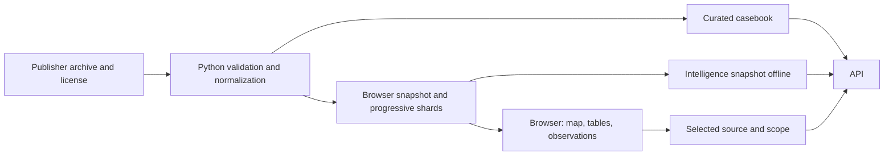
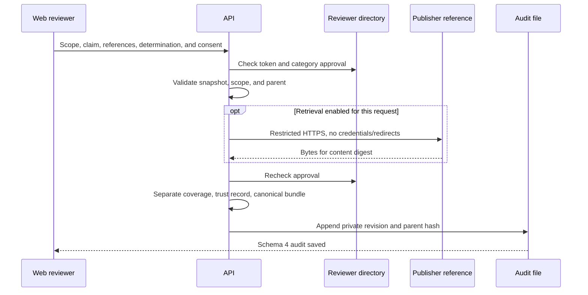

# Data flow and audit lifecycle

[Architecture](overview.md) · [Repository map](../repository-map.md) · [Data and claims](../product/data-and-claims.md)

This guide follows data from publisher archive to report. The offline pipeline, local/shared investigation state, and server audits have different lifecycles.

## 1. Archive → snapshot → display

1. Store archive identity, retrieval time, license, and archive SHA-256. Historical inputs remain traceable.
2. The builder normalizes sources/plumes while preserving IDs, dates, units, missing values, and uncertainty. Plume records without a source ID are not joined by guessing location.
3. The browser uses manifests/progressive shards to load data without rendering every observation at once. Monthly geometries and publisher indicators load as needed.
4. The casebook provides a subset of sources with reference context. Not every source on the map automatically has a curated document-evidence set.
5. Intelligence is built offline from the pinned snapshot. The API checks the input digest, upstream identity, and artifact structure before serving insights/rankings.
6. Browser import changes only the browser's local data context; it does not upload an archive or update the server snapshot. Do not assume audits are available for mismatched data.

Primary reproduction sources: [casebook/snapshot/intelligence](../../data/real/README.md), [publisher indicators](../../data/real/mars_publisher_archives/README.md), [geometry](mars-publisher-geometry.md), and the [recurrence ledger](../product/prospective-recurrence.md). Use the commands in those sources so paths/hashes are not duplicated inconsistently.

## 2. Source → investigation → scope

Browser investigations store the claim, period/event, question, status, next action, and evidence request. Their key includes real/DEMO mode, source, snapshot/archive, and work ID. Multiple work IDs can use the same source. Saved scope and claims can be restored without implying that a new server audit exists.

Per-tab drafts help recover edits. Tokens, inspection confirmations, retrieval choices, and publication consent require a new action. Saving notes does not create an audit, change a verdict, or send a message to an operator.

### Optional team workspace

The signed reviewer connects to `/api/case-work/session`; the server checks current directory authority. List/detail are bound to the snapshot/archive and filtered by claim type. Save sends context, draft, and expected revision; the server validates the source/scope/assignee/audit link, rechecks access, then appends history with the actor from the token. One writer holds the OS lock and writes private state with an atomic flush before ACK. The work file is separate from the audit bundle and does not change the assessment hash.

Two writers on the same revision produce one save and one conflict. The tab draft is retained; the user compares the latest version before rebasing or reloading. Browser import uses a preview and a new server ID without deleting local notes. The queue requires an explicit refresh; a failed refresh hides stale data and disables save. See the [runbook](../development/shared-casework.md) for restart, markers, backup/restore, and single-local-instance limits.

## 3. Scope → assessment → revision

### Rules baseline

`POST /api/audits` validates the source/claim and optional scope, resolves pinned data, then selects evidence. UI coverage uses the same selector. Scope excludes dates outside the period, records without dates, mismatched events, different recipients, and incomplete action/follow-up metadata.

The result describes only how registered evidence relates to the claim. Notification/mitigation claims from bundled data remain insufficient when only a publisher flag or report link is available.

### Human assessment without AI

The reviewer can choose insufficient without references; supported requires an appropriate reference type, and contradicted requires an appropriate contrary record. Metadata checks do not authenticate contents. Up to 12 references are allowed. Retrieval saves status/hash, not report contents. A stale parent is rejected so a new revision cannot silently rely on an older version.

### Optional Document AI

The PDF/TXT manifest and file hash are checked locally. An authorized excerpt is sent only after consent and provider/token configuration. The API matches exact quotes against the excerpt and saves schema 3 without the full excerpt. Subsequent human review is a separate revision. This path remains source-level and has its own publication rules; schema 4 summary consent cannot replace them.

## 4. Revision → access → export

| Output | Read by | Contents and limits |
|---|---|---|
| Full schema 2 | Public if visibility policy allows | Baseline; recipient scope remains private |
| Full schema 3 | Reviewer; public only if approval/consent requirements are met | Selected quotes/metadata may be sensitive; the full excerpt is not stored |
| Full schema 4 / JSON `PRIVATE-…` | Authorized reader | Claim, rationale, identity, and reference metadata remain private |
| Markdown investigation brief | User preparing the brief | Omits private assessment details and quoted content; not a replacement for the JSON verifier |
| Public transparency summary | Public, when revision consent is given | Allowlisted fields and hashes only; no access to private evidence |

Private history retrieval filters allowed categories before pagination. Public summaries are created only from bundles with valid integrity. The summary records historical results/assurance at save time; it does not state that a reviewer remains authorized. Separate publication events in audit envelope version 2 record `published`, `superseded`, and `withdrawn` without changing the bundle/hash. A newly consented revision replaces the active publication for the same scope/claim; private revisions do not change public status. The reader uses one audit+event snapshot, then selects the latest public version before pagination. Live status is not covered by the historical checksum; the [lifecycle runbook](../development/publication-lifecycle.md) explains migration, CAS, and rollback limits.

Exports distinguish observations actually cited by the audit from `historicalContext`. Rows are included only when the source and required snapshot binding match. Source data from another snapshot is not presented as evidence in the saved audit.

## Integrity layers

| Layer | Hashed object | What can be checked |
|---|---|---|
| Archive/file digest | Archive or artifact bytes | File consistency with the manifest/provenance |
| Bundle hash | Canonical evidence bundle | Integrity of one audit revision's contents |
| Export checksum | JSON report envelope | Integrity of the export context and included audit |
| Summary hash | Canonical `summary` object | Consistency of visible public fields |
| Blockchain receipt | Hash commitment in a registry event | Matching hash/issuer/version/transaction, if a receipt actually exists |

Local checksums are unsigned: anyone who changes the content and recalculates the checksum can create another internally consistent artifact. A hash is not proof of publisher identity, independent publication time, content accuracy, or mitigation outcome. Writes/reconciliation use durable intents in the same audit envelope. The transaction hash is saved before broadcast; uncertain status remains pending. See [P2 recovery](../development/blockchain-recovery.md).

## 5. Follow-up

**Add saved request to follow-up** explicitly copies an evidence request into a matching investigation draft, along with the audit ID/hash. Work status does not change, and the user must still save. New evidence can be used in a later assessment revision. Changes to notes do not alter an older bundle.

For storage, revocation, and full publication limits, see [trust and transparency](../product/trust-and-transparency.md) and the [user workflow](../product/user-workflow.md).
