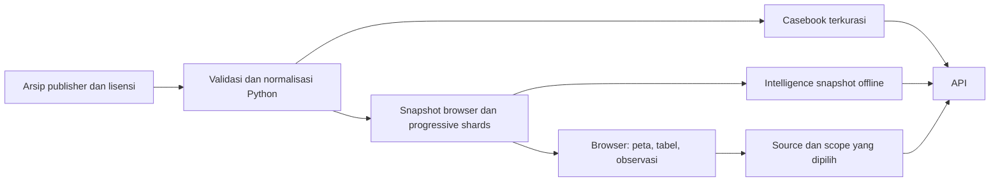

# Aliran data dan siklus audit

[Arsitektur](overview.md) · [Peta repo](../repository-map.md) · [Data dan claims](../product/data-and-claims.md)

Panduan ini mengikuti perjalanan data dari arsip penerbit hingga laporan. Pipeline offline, state investigasi lokal/bersama, dan audit server mempunyai siklus hidup yang berbeda.

## 1. Arsip → snapshot → tampilan

1. Simpan identitas arsip, waktu retrieval, lisensi dan archive SHA-256. Input historis tetap dapat ditelusuri.
2. Builder menormalisasi source/plume dan mempertahankan ID, tanggal, unit, nilai kosong serta ketidakpastian. Record plume tanpa source ID tidak dijoin melalui tebakan lokasi.
3. Browser menggunakan manifest/progressive shards untuk memuat data tanpa merender semua observasi sekaligus. Geometri bulanan dan indikator publisher dimuat sesuai kebutuhan.
4. Casebook menyediakan subset sumber dengan konteks referensi. Seluruh sumber pada peta tidak otomatis mempunyai kumpulan bukti dokumen terkurasi.
5. Intelligence dibangun offline dari snapshot yang dipin. API memeriksa input digest, identitas upstream dan struktur artefak sebelum menyajikan insight/ranking.
6. Import browser hanya mengganti konteks data lokal browser; tidak mengunggah arsip atau memperbarui snapshot server. Audit terhadap data yang tidak cocok tidak boleh diasumsikan tersedia.

Sumber reproduksi utama: [casebook/snapshot/intelligence](../../data/real/README.md), [indikator publisher](../../data/real/mars_publisher_archives/README.md), [geometri](mars-publisher-geometry.md), dan [ledger recurrence](../product/prospective-recurrence.md). Gunakan perintah di sumber tersebut agar path/hash tidak mempunyai salinan instruksi yang berbeda.

## 2. Source → investigation → scope

Investigasi browser menyimpan claim, periode/kejadian, pertanyaan, status, next action dan permintaan bukti. Kuncinya mencakup real/DEMO mode, source, snapshot/archive dan work ID. Beberapa work ID dapat memakai sumber yang sama. Scope dan claim tersimpan dapat dipulihkan tanpa menyimpulkan bahwa ada audit server baru.

Draft per tab membantu pemulihan edit. Token, konfirmasi inspeksi, pilihan retrieval dan consent publikasi memerlukan tindakan baru. Save catatan tidak membuat audit, tidak mengubah verdict, dan tidak mengirim pesan ke operator.

### Workspace tim opsional

Signed reviewer terhubung ke `/api/case-work/session`; server memeriksa directory authority aktif. List/detail terikat snapshot/archive dan disaring berdasarkan claim type. Save mengirim context, draft, serta expected revision; server memvalidasi source/scope/assignee/link audit, memeriksa ulang akses, lalu menambah riwayat dengan aktor dari token. Satu writer memegang lock OS, menulis state privat dengan flush atomik sebelum ACK. File work terpisah dari bundle audit dan tidak mengubah hash penilaian.

Dua penulis pada revisi yang sama menghasilkan satu save dan satu konflik. Draft tab dipertahankan; pengguna membandingkan versi terbaru sebelum rebase atau reload. Import browser memakai preview dan ID server baru tanpa menghapus catatan lokal. Queue perlu refresh eksplisit; refresh gagal menyembunyikan data lama dan menonaktifkan save. Lihat [runbook](../development/shared-casework.md) untuk restart, marker, backup/restore dan batas satu instance lokal.

## 3. Scope → penilaian → revisi

### Rules baseline

`POST /api/audits` memvalidasi source/claim dan optional scope, meresolusi data yang dipin, lalu menyeleksi bukti. Coverage di UI memakai selector yang sama. Scope menyingkirkan tanggal di luar periode, record tanpa tanggal, event yang tidak cocok, penerima yang berbeda, dan metadata tindakan/follow-up yang belum lengkap.

Hasil hanya menjelaskan hubungan bukti terdaftar dengan claim. Notifikasi/mitigasi dari data bawaan tetap insufficient bila hanya tersedia flag publisher atau tautan laporan.

### Human assessment tanpa AI

Reviewer dapat menentukan insufficient tanpa referensi; supported memerlukan tipe referensi yang sesuai dan contradicted memerlukan contrary record yang sesuai. Pemeriksaan metadata tidak mengautentikasi isi. Maksimal 12 referensi. Retrieval menyimpan status/hash, tidak menyimpan isi laporan. Parent yang stale ditolak agar revisi baru tidak diam-diam berdasar pada versi lama.

### Document AI opsional

Manifest PDF/TXT dan hash file diperiksa lokal. Excerpt yang diizinkan dikirim hanya setelah consent dan konfigurasi provider/token. API mencocokkan kutipan persis terhadap excerpt dan menyimpan schema 3 tanpa full excerpt. Review manusia berikutnya menjadi revisi terpisah. Jalur ini tetap source-level dan memiliki aturan publikasi tersendiri; tidak memakai consent ringkasan schema 4 sebagai penggantinya.

## 4. Revisi → akses → ekspor

| Keluaran | Dibaca oleh | Isi dan batas |
|---|---|---|
| Full schema 2 | Publik jika kebijakan visibility mengizinkan | Baseline; scope berisi penerima tetap privat |
| Full schema 3 | Reviewer; publik hanya jika syarat approval/consent lengkap | Kutipan/metadata terpilih dapat sensitif; full excerpt tidak disimpan |
| Full schema 4 / JSON `PRIVATE-…` | Pembaca berwenang | Claim, rationale, identitas dan metadata referensi tetap privat |
| Markdown investigation brief | Pengguna yang menyiapkan brief | Menghilangkan detail penilaian privat dan isi kutipan; bukan pengganti JSON verifier |
| Public transparency summary | Publik, bila consent revisi diberikan | Hanya field allowlist dan hash; tidak memberi akses bukti privat |

Pengambilan history privat memfilter kategori yang diizinkan sebelum pagination. Ringkasan publik hanya dibuat dari bundle dengan integritas valid. Summary merekam hasil/assurance historis saat save; tidak menyatakan reviewer masih berwenang. Event publikasi terpisah dalam envelope audit versi 2 mencatat `published`, `superseded` dan `withdrawn` tanpa mengubah bundle/hash. Revisi berconsent baru menggantikan publikasi aktif pada scope/claim sama; revisi privat tidak mengubah status publik. Reader memakai satu snapshot audit+event, lalu memilih versi publik terakhir sebelum pagination. Status live tidak tercakup oleh checksum historis; [runbook lifecycle](../development/publication-lifecycle.md) menjelaskan migrasi, CAS dan batas rollback.

Ekspor membedakan observasi yang benar-benar dikutip audit dari `historicalContext`. Baris hanya disertakan bila source dan binding snapshot yang diperlukan cocok. Data sumber dari snapshot lain tidak dimasukkan seolah-olah menjadi bukti audit tersimpan.

## Lapisan integritas

| Lapisan | Objek yang di-hash | Apa yang dapat diperiksa |
|---|---|---|
| Archive/file digest | Bytes arsip atau artefak | Konsistensi file terhadap manifest/provenance |
| Bundle hash | Canonical evidence bundle | Integritas isi satu revisi audit |
| Export checksum | Amplop JSON laporan | Integritas konteks ekspor beserta audit yang dibawa |
| Summary hash | Canonical objek `summary` | Konsistensi field publik yang terlihat |
| Receipt blockchain | Komitmen hash dalam event registry | Hash/issuer/versi/transaksi yang sesuai, bila receipt benar-benar ada |

Checksum lokal tidak ditandatangani: pihak yang mengubah isi dan menghitung checksum baru dapat membuat artefak lain yang konsisten. Hash bukan bukti identitas penerbit, waktu publikasi independen, keakuratan isi, atau hasil mitigasi. Write/reconcile memakai intent durabel dalam envelope audit yang sama. Hash transaksi tersimpan sebelum broadcast; status tidak pasti tetap pending. Lihat [pemulihan P2](../development/blockchain-recovery.md).

## 5. Tindak lanjut

**Add saved request to follow-up** menyalin permintaan bukti secara eksplisit ke draft investigasi yang cocok, membawa audit ID/hash. Status kerja tidak berubah dan pengguna tetap harus save. Bukti baru dapat menjadi revisi penilaian berikutnya. Perubahan notes tidak mengubah bundle lama.

Untuk batas storage, revocation dan publikasi lengkap, baca [trust dan transparansi](../product/trust-and-transparency.md) serta [alur penggunaan](../product/user-workflow.md).
