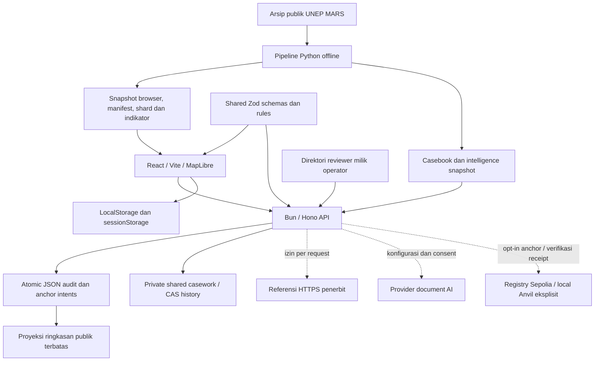
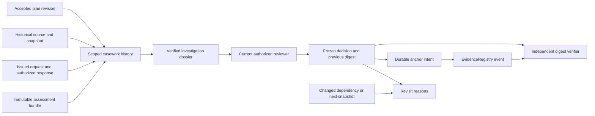

# Arsitektur sistem

[Pusat dokumentasi](../README.md) · [Peta repo](../repository-map.md) · [Aliran data](data-flow.md) · [Referensi API](api-reference.md)

**Panduan aktif — 20 Oktober 2026.** MethaneResponse adalah proof of concept investigasi historis. Web dan API dapat berjalan dengan data bawaan. Pipeline dijalankan offline untuk membuat artefak; tidak ada worker ingestion yang terus berjalan di belakang API.

## 1. Gambaran komponen

| Komponen | Tanggung jawab | Batas |
|---|---|---|
| Web | Peta, konteks sumber, scope, coverage, editor, history, laporan, verifier | Token di memori; catatan browser atau workspace tim terotorisasi |
| API | Memvalidasi input/provenance, menerapkan akses, membuat bundle dan menyimpan revisi | Satu proses, rate limit lokal; tidak mengirim notifikasi operator |
| Shared | Kontrak Zod, tipe dan selector kelayakan bukti untuk UI/API | Skema memvalidasi struktur; tidak mengesahkan kebenaran isinya |
| Pipeline | Membentuk dataset/analisis reproduktif dari arsip versi tetap | Tidak menyediakan deteksi satelit baru atau feed langsung |
| File store | Menyimpan revisi audit tanpa menimpa bundle lama | Bukan penyimpanan multi-instance atau backup jarak jauh |
| Integrasi opsional | Document AI, retrieval referensi, pemeriksaan receipt | Memerlukan konfigurasi/izin yang sesuai; bukan prasyarat baseline |

## 2. Tiga jalur penilaian

| Jalur | Input dan proses | Bundle | Akses |
|---|---|---|---|
| Rules baseline | Source/claim, opsional scope; cek referensi yang sesuai | Schema 2 | Umumnya publik; scope penerima privat tetap dilindungi |
| Document AI | Excerpt yang hak pemrosesannya disetujui, validasi kutipan, lalu review manusia sebagai revisi terpisah | Schema 3 | Privat secara default; publikasi mengikuti persetujuan submitter dan reviewer serta status approval |
| Human assessment | Scope wajib, exact claim, metadata referensi yang diperiksa, determination, alasan, dan trust controls | Schema 4 | Bundle lengkap selalu privat; hanya ringkasan allowlist dapat dibuka dengan consent per revisi |

Rules baseline menggunakan selector bersama untuk periode, kejadian, penerima, serta metadata tindakan/follow-up. Reviewer membuat determination sendiri; hasil coverage tetap ditampilkan terpisah. `feedback` tidak menjadi bukti mitigasi dan `metadata_notification` tidak menjadi bukti penerimaan notifikasi.

Document AI masih pada tingkat source. Kutipan harus cocok persis dengan excerpt yang diberikan. Revisi review ditautkan ke parent digest; hasil AI tidak langsung menjadi keputusan manusia atau bukti fisik. Detail penggunaan ada di [alur pengguna](../product/user-workflow.md).

## 3. Identitas, versi, dan hash

Source ID menunjukkan sumber menurut MARS. Case ID dan claim mengelompokkan revisi audit; scope persis memiliki identitas history tersendiri. Snapshot ID dan archive hash mencegah penggabungan konteks dataset yang berbeda. Work ID membedakan beberapa investigasi lokal atau bersama untuk source/snapshot yang sama; ia bukan ID audit server.

Bundle audit memakai canonical JSON dan SHA-256. Revisi baru menghasilkan bundle baru; receipt metadata berada di luar bundle. Laporan JSON menambahkan checksum amplop ekspor, sedangkan ringkasan publik mempunyai checksum tersendiri. Ketiga digest mencakup objek berbeda. Lihat [data-flow](data-flow.md#lapisan-integritas).

## 4. Penyimpanan dan akses

| Data | Lokasi aktif | Sifat |
|---|---|---|
| Data MARS publik | `data/real/`, `apps/web/public/data/` | Artefak versi tetap dengan provenance/lisensi |
| Analisis offline | `data/processed/` | Binding snapshot dan hash input diperiksa API |
| Revisi audit | `AUDIT_STORE_PATH`, default `data/state/audits.json` | Antrean write satu proses dan penggantian file atomik |
| Investigasi bersama | `AUDIT_STORE_PATH` + `.case-work.json` | CAS/revision/history privat, fsync, initialization marker; satu API dengan kernel lock |
| Catatan investigasi/preferensi lokal | LocalStorage | Mutable, satu browser; tidak masuk hash audit |
| Draft belum disimpan | SessionStorage | Per tab; tidak menyimpan token atau consent inspeksi/publikasi/retrieval |
| Token yang diisi di UI | Memori halaman | Tidak dipulihkan dari browser storage |
| Direktori reviewer | Path privat server | Dibaca kembali per operasi; terpisah dari aset web dan bukti publik |

Token reviewer berscope `private_read`, `review`, dan `anchor`. Direktori operator menambah kategori kewenangan, expiry dan revocation. Untuk jalur audit compatibility tanpa strict mode, approval directory unverified/expired masih dapat diterima dengan label batas assurance. `disabled: true` merevokasi approval; menghapus entry bukan pengganti revocation. Konflik tetap deklarasi mandiri. Detail kebijakan ada di [trust dan transparansi](../product/trust-and-transparency.md).

P1 shared casework selalu memerlukan signed token dan current operator-attested authority per claim; flag compatibility dan legacy token tidak berlaku. Baca [runbook tim](../development/shared-casework.md) untuk matriks baca/tulis, batas kapasitas dan pemulihan.

Full human assessment, termasuk export JSON-nya, adalah data privat. History privat memakai otorisasi dan respons `no-store`. Lock di UI membersihkan cache/seleksi privat dan recovery manusia. Ringkasan publik tidak memuat exact claim, penerima, identitas, URL/locator referensi atau alasan bebas. Checksum ringkasan tidak memberi akses untuk memeriksa bukti yang disembunyikan.

## 5. Keputusan arsitektur

| Keputusan | Alasan dan konsekuensi |
|---|---|
| [File lokal, tanpa database](decisions/2026-10-15-local-prototype-no-database.md) | Fokus prototype pada MARS dan alur investigasi; tidak ada migrasi/DB setup, tidak mendukung replika write bersama |
| [Shared casework satu writer](decisions/2026-10-17-shared-casework-single-writer.md) | Memperluas ADR lokal untuk tim kecil: file privat terpisah, CAS/history, lock API dan backup offline; remote belum diuji |
| Snapshot dipin dan diproses offline | Alur dapat diulang dan versi data terlihat; refresh perlu tindakan eksplisit |
| Rules sebelum model | Ada baseline yang dapat dijelaskan dan dibandingkan; model tetap opsional |
| Catatan kerja terpisah dari penilaian | Notes/status dapat berubah tanpa mengubah audit yang sudah disimpan |
| Full schema 4 privat | Publikasi melalui proyeksi field tetap dengan consent per revisi; koreksi/withdrawal tercatat tanpa menghapus ringkasan historis. [Lifecycle P3](../development/publication-lifecycle.md) |
| Chain write dengan opt-in | Intent dan receipt berada dalam satu envelope audit; pre-sign/hash → fsync intent → broadcast → reconcile. Anvil lokal teruji; Sepolia publik diotorisasi tetapi belum deployed/dibuktikan. [Runbook P2](../development/blockchain-recovery.md) |

Kode Solidity dan receipt verifier tetap tersedia. Receipt yang valid membuktikan komitmen hash dan kronologi versi, bukan keaslian dokumen atau perbaikan peralatan.

## 6. Penanganan kegagalan

- `/api/health` dapat mengembalikan `503` jika store, casebook atau status rate limiter tidak siap. Health tidak menyatakan semua integrasi opsional aktif.
- Snapshot intelligence yang hilang, rusak atau tidak cocok ditolak; fallback casebook hanya digunakan pada jalur yang mengizinkan provenance yang sesuai.
- Kegagalan penyimpanan browser terlihat sebagai belum tersimpan. Revisi mendeteksi save stale secara berurutan, tetapi write antartab tidak transactional.
- State tim rusak/berizin terbuka/hilang setelah inisialisasi menolak write; refresh gagal menyembunyikan queue/history lama dan mempertahankan draft. Marker tidak mendeteksi kehilangan seluruh volume.
- Parent human assessment yang sudah bukan revisi terbaru ditolak dengan konflik. Pengguna perlu membuka revisi terbaru sebelum menyimpan ulang.
- Tile/WebGL memiliki fallback; imagery tetap konteks geografis, bukan bukti pengukuran MARS.
- Mismatch digest referensi mencegah save determination supported/contradicted. Retrieval gagal tidak diberi label sukses dan tidak otomatis membuktikan referensi salah.

Kondisi eksternal yang belum dibuktikan tercantum di [status implementasi](../release/current-implementation-status.md). Catatan desain database/anchor recovery lama di [indeks arsitektur](README.md) adalah arsip.

## Investigasi terhubung dan batas kepercayaan

[Workflow dan operasi](../development/connected-investigations.md) menghubungkan komponen yang ada tanpa database atau kontrak tambahan:

- **Join, bukan penyalinan audit:** casework menyimpan ID/digest assessment, revisi persetujuan rencana dan report perubahan. Dossier memuat material lengkap untuk memeriksa hubungan lintas artefak. Freezing menyalin dossier tepat agar perubahan journal kemudian tidak mengubah keputusan terdahulu.
- **Privat, bukan proyeksi publik:** signed token, current directory authority dan scope diperiksa sebelum baca/tulis serta setelah operasi asynchronous yang menghasilkan respons privat. Data dari ekspor privat tidak otomatis menjadi public summary. Tidak ada token atau identitas reviewer dalam calldata; registry key mengandung hash context/work identity.
- **Draft, bukan event eksternal:** penerimaan respons, hash berkas dan hak pemrosesan merupakan deklarasi reviewer. Tidak ada unduhan, pengiriman pesan, pemanggilan model, atau anchor yang dipicu hanya dengan menambah event.
- **Satu writer:** audit, keputusan dan durable intents memakai satu atomic state envelope; legacy audit dan keputusan berbagi pemeriksaan pending/nonce. Casework dan plan journal mempertahankan CAS/history masing-masing. Tidak ada transaksi multi-file atau dukungan multi-instance; baca ulang material/revisi sebelum persetujuan.
- **Integrity, bukan physical outcome:** verifier membutuhkan digest tepercaya terpisah, lalu memeriksa canonical payload, hubungan dan replay. Chain verification juga memeriksa receipt/event/head. Revisit merekomendasikan pemeriksaan baru; tidak menulis ulang determination historis.

Dossier/decision validators dan panel investigasi dimuat pada jalur workspace terkait. App entry tetap mengikuti budget gzip yang sama. Kontrak lama dan namespace audit v2 dipertahankan; envelope 3 dan namespace keputusan baru dijelaskan pada panduan operasi beserta batas dan rollback.
