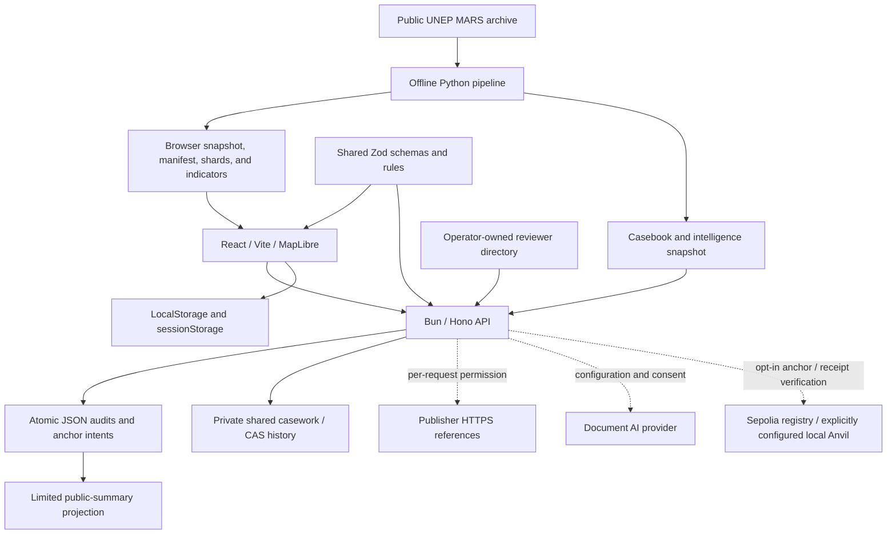
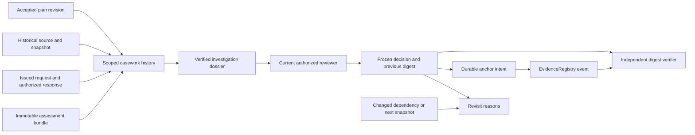

# System architecture

[Documentation index](../README.md) · [Repository map](../repository-map.md) · [Data flow](data-flow.md) · [API reference](api-reference.md)

**Active guide — 20 October 2026.** MethaneResponse is a proof of concept for historical investigations. The web app and API can run with bundled data. The pipeline runs offline to build artifacts; no ingestion worker runs continuously behind the API.

## 1. Component overview

| Component | Responsibility | Limit |
|---|---|---|
| Web | Map, source context, scope, coverage, editor, history, reports, verifier | Tokens in memory; browser notes or an authorized team workspace |
| API | Validates input/provenance, enforces access, builds bundles, and stores revisions | One process, local rate limits; does not send operator notifications |
| Shared | Zod contracts, types, and evidence-eligibility selectors for UI/API | Schemas validate structure; they do not establish that contents are true |
| Pipeline | Builds reproducible datasets/analysis from fixed-version archives | Does not provide new satellite detections or a live feed |
| File store | Stores audit revisions without overwriting older bundles | Not multi-instance storage or remote backup |
| Optional integrations | Document AI, reference retrieval, receipt checks | Require the appropriate configuration/permission; not required for the baseline |

## 2. Three assessment paths

| Path | Input and process | Bundle | Access |
|---|---|---|---|
| Rules baseline | Source/claim, optional scope, and eligible-reference checks | Schema 2 | Generally public; private recipient scope remains protected |
| Document AI | Excerpt cleared for processing, citation validation, then human review as a separate revision | Schema 3 | Private by default; publication follows submitter/reviewer consent and approval status |
| Human assessment | Required scope, exact claim, inspected reference metadata, determination, rationale, and trust controls | Schema 4 | The full bundle is always private; only an allowlisted summary may be disclosed with per-revision consent |

The rules baseline uses a shared selector for period, event, recipient, and action/follow-up metadata. The reviewer makes the determination; coverage results remain separate. `feedback` is not mitigation evidence, and `metadata_notification` is not proof that a notification was received.

Document AI remains source-level. Quotes must match the submitted excerpt exactly. Review revisions are linked to a parent digest; AI output does not itself become a human decision or physical evidence. See the [user workflow](../product/user-workflow.md) for details.

## 3. Identity, versions, and hashes

The source ID identifies a source according to MARS. Case ID and claim group audit revisions; each exact scope has its own history identity. Snapshot ID and archive hash prevent merging different dataset contexts. Work ID distinguishes multiple local or shared investigations for the same source/snapshot; it is not a server audit ID.

Audit bundles use canonical JSON and SHA-256. A new revision creates a new bundle; receipt metadata is outside the bundle. JSON reports add an export-envelope checksum, while public summaries have their own checksum. These three digests cover different objects. See the [data-flow integrity layers](data-flow.md#integrity-layers).

## 4. Storage and access

| Data | Active location | Properties |
|---|---|---|
| Public MARS data | `data/real/`, `apps/web/public/data/` | Fixed-version artifacts with provenance/license |
| Offline analysis | `data/processed/` | Snapshot binding and input hashes are checked by the API |
| Audit revisions | `AUDIT_STORE_PATH`, default `data/state/audits.json` | Single-process write queue and atomic file replacement |
| Shared investigations | `AUDIT_STORE_PATH` + `.case-work.json` | Private CAS/revision/history, fsync, initialization marker; one API with a kernel lock |
| Local investigation notes/preferences | LocalStorage | Mutable, one browser; not included in audit hashes |
| Unsaved drafts | SessionStorage | Per tab; does not store tokens or inspection/publication/retrieval consent |
| Tokens entered in the UI | Page memory | Not restored from browser storage |
| Reviewer directory | Private server path | Reread on each operation; separate from web assets and public evidence |

Reviewer tokens use the `private_read`, `review`, and `anchor` scopes. The operator directory adds authority categories, expiry, and revocation. In the audit compatibility path without strict mode, unverified/expired directory approval may still be accepted with an assurance-limitation label. `disabled: true` revokes approval; deleting an entry is not a substitute for revocation. Conflict declarations remain self-reported. See [trust and transparency](../product/trust-and-transparency.md) for policy details.

P1 shared casework always requires a signed token and current operator-attested authority for each claim; compatibility flags and legacy tokens do not apply. See the [team runbook](../development/shared-casework.md) for read/write matrices, capacity limits, and recovery.

The full human assessment, including its JSON export, is private data. Private history uses authorization and `no-store` responses. Locking the UI clears private caches/selections and human-assessment recovery data. Public summaries do not contain the exact claim, recipient, identity, reference URL/locator, or free-text rationale. A summary checksum does not grant access to inspect hidden evidence.

## 5. Architecture decisions

| Decision | Rationale and consequences |
|---|---|
| [Local files, no database](decisions/2026-10-15-local-prototype-no-database.md) | Focuses the prototype on MARS and investigation workflows; no migrations/DB setup and no shared write replicas |
| [Shared casework with one writer](decisions/2026-10-17-shared-casework-single-writer.md) | Extends the local ADR for a small team: separate private files, CAS/history, API lock, and offline backups; remote use is untested |
| Pinned snapshots processed offline | Workflows are reproducible and data versions visible; refresh requires an explicit action |
| Rules before models | Provides an explainable baseline for comparison; models remain optional |
| Work notes separate from assessments | Notes/status can change without modifying saved audits |
| Private full schema 4 | Publication uses a fixed-field projection with per-revision consent; corrections/withdrawals are recorded without deleting historical summaries. [P3 lifecycle](../development/publication-lifecycle.md) |
| Opt-in chain writes | Intent and receipt share one audit envelope; pre-sign/hash → fsync intent → broadcast → reconcile. Local Anvil is tested; public Sepolia is authorized but not deployed/verified. [P2 runbook](../development/blockchain-recovery.md) |

The Solidity code and receipt verifier remain available. A valid receipt proves a hash commitment and version chronology, not document authenticity or equipment repair.

## 6. Failure handling

- `/api/health` may return `503` if the store, casebook, or rate-limiter status is not ready. Health does not mean all optional integrations are active.
- Missing, corrupt, or mismatched intelligence snapshots are rejected; the casebook fallback is used only on paths whose provenance requirements allow it.
- Browser-storage failures appear as unsaved changes. Revisions detect sequential stale saves, but writes across tabs are not transactional.
- Corrupt/open-permission team state or state missing after initialization blocks writes; a failed refresh hides stale queue/history and preserves the draft. The marker cannot detect loss of the entire volume.
- A human-assessment parent that is no longer the latest revision is rejected as a conflict. The user must open the latest revision before saving again.
- Tiles/WebGL have fallbacks; imagery remains geographic context, not MARS measurement evidence.
- A reference-digest mismatch blocks saving a `supported`/`contradicted` determination. Failed retrieval is not labeled successful and does not automatically prove a reference false.

Unverified external conditions are listed in [implementation status](../release/current-implementation-status.md). Older database/anchor-recovery design notes in the [architecture index](README.md) are archives.

## Connected investigations and trust boundaries

The [workflow and operations guide](../development/connected-investigations.md) links the existing components without a database or additional contract:

- **Join, not audit copying:** casework stores assessment IDs/digests, plan-approval revisions, and change reports. The dossier contains the material needed to check relationships across artifacts. Freezing copies the exact dossier so later journal changes do not alter an earlier decision.
- **Private, not a public projection:** signed tokens, current directory authority, and scope are checked before reads/writes and after asynchronous operations that produce private responses. Data from private exports does not automatically become a public summary. No token or reviewer identity is included in calldata; the registry key contains a context/work identity hash.
- **Draft, not an external event:** response receipt, file hashes, and processing rights are reviewer declarations. Adding an event alone does not download files, send messages, call a model, or anchor anything.
- **One writer:** audits, decisions, and durable intents use one atomic state envelope; legacy audits and decisions share pending/nonce checks. Casework and plan journals retain their own CAS/history. There are no multi-file transactions or multi-instance support; reread the material/revision before approval.
- **Integrity, not physical outcome:** the verifier requires a separately trusted digest, then checks the canonical payload, relationships, and replay. Chain verification also checks the receipt/event/head. Revisit recommends a new check; it does not rewrite a historical determination.

Dossier/decision validators and investigation panels are loaded on the relevant workspace paths. The app entry remains within the same gzip budget. The legacy contract and audit v2 namespace are retained; envelope 3 and the new decision namespace are described in the operations guide with their limits and rollback details.
