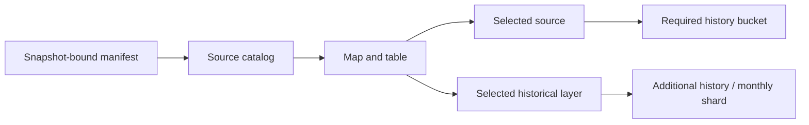

# Historical MARS map

[Architecture](overview.md) · [Repository map](../repository-map.md) · [Data flow](data-flow.md)

**Active guide — 17 October 2026.** MapLibre GL displays pinned historical data with attributed basemaps/geometries. The map is not a methane sensor, concentration surface, or indicator of current emissions.

## Displayed data

- Active snapshot: `unep-mars-675417694883`, with 4,218 source rows and 30,414 plume rows through 13 September 2026 UTC.
- Sources and plumes use the publisher's identifiers, coordinates, dates, flux/uncertainty, and missing values.
- Plumes without a source ID remain unlinked; they are not linked by guessed geographic proximity.
- The four-source casebook is a curated subset. Sources on the map can be checked by the baseline if available in the matching server snapshot; non-curated sources do not automatically have supporting documents.
- **DEMO** synthetic mode remains separate and is not presented as real observations.

Release references, license, hashes, and rebuild instructions: [data/real/README.md](../../data/real/README.md).

## Browser loading

The progressive loader fetches the catalog first, then history buckets as needed. Hashes, size/representation, snapshot ID, and archive binding are checked. The full compressed snapshot remains available for paths that require it and for appropriate fallbacks. A worker assists with full-snapshot verification/parsing; worker failure does not bypass integrity checks.

Publisher geometry uses a checked index and monthly shards. Only the selected month is loaded for the polygon layer on supported tiers. Case details/Auditor use the shared shard, not an imagery file created per source. The [geometry document](mars-publisher-geometry.md) records counts, hashes, matching, and scientific limitations.

## Layers and their meaning

| Display | Meaning | Limit |
|---|---|---|
| Source markers / clusters | Location and count of source records | Not concentration or count of active leaks |
| Source density | Density of source locations in the snapshot | Not methane concentration |
| Reported flux overlay | Historical record values or rendering aggregation described in the legend | Not a continuous sensor field or current flux |
| Selected-month publisher geometry | Publisher GeoJSON shapes for matching records | Not defined as a project-verified physical plume boundary |
| Investigation priority | Heuristic from analysis of a matching snapshot | Not a claim-truth or physical-emissions probability |
| Esri / OpenFreeMap | Geographic context and navigation | Capture dates/resolutions vary; not imagery from a MARS overpass |
| NASA GIBS / terrain / day-night | Dated visual context and Earth rendering | Not case evidence, live weather, or surface methane |

Missing flux values are labeled/colored as missing, not converted to zero. DEMO labels, provenance, and attribution remain visible. Layers do not change observation contents or audit decisions.

## Interactions and failures

Source markers can be selected, clusters expanded, and the camera focused. **View full case** opens details over the map; **Open in Map Explorer** from Cases uses the stored coordinates. Period/history controls do not turn an empty period into evidence of zero emissions.

MapPanel is loaded separately from the dashboard entry. Rendering quality can adapt to the device; low-power mode uses a lighter representation. Tile outages, WebGL/context loss, and geometry mismatches are shown with a fallback/status, not fabricated imagery or polygons. See [Earth rendering](earth-rendering.md) for dated rendering details. FPS/performance claims require measurements on an appropriate device.

## Import and updates

GeoJSON import is a local browser operation: the archive is not uploaded to the API, and the server snapshot is not replaced. Baseline/manual/AI paths can use only sources and bindings accepted by the server. A file appearing on the map does not mean the dataset has been promoted for audit use.

For a new release, follow the provenance → import/validation → builder → manifest/hash → binding check → release review process in the [data guide](../../data/real/README.md). `import_mars_map.py` remains a separate import tool; creating a JSON file with it does not automatically replace all progressive assets, intelligence, and active manifests. There is no scheduled data refresh.

## Rights and evidence

The MARS dataset is subject to CC BY-NC-SA 4.0; tiles/imagery and linked reports have separate rights. Preserve attribution as described in [NOTICE](../../NOTICE).

[Browser evidence](../evidence/README.md) and [dated performance notes](../development/performance-optimization.md) show results for their original dataset/revision. Older screenshots do not prove the current UI, live hosting, or performance on a physical phone.
