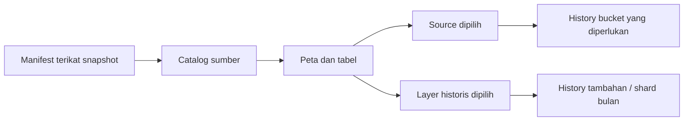

# Peta historis MARS

[Arsitektur](overview.md) · [Peta repository](../repository-map.md) · [Alur data](data-flow.md)

**Panduan aktif — 17 Oktober 2026.** MapLibre GL menampilkan data historis yang dipin, dengan basemap/geometri beratribusi. Peta tidak menjadi sensor metana, concentration surface, atau penentu kondisi emisi saat ini.

## Data yang tampil

- Snapshot aktif: `unep-mars-675417694883`, 4.218 source rows dan 30.414 plume rows sampai 13 September 2026 UTC.
- Source dan plume memakai identifier, koordinat, tanggal, flux/uncertainty serta nilai kosong dari penerbit.
- Plume tanpa source ID tetap tidak tertaut; tidak dihubungkan dengan tebakan kedekatan lokasi.
- Casebook empat sumber adalah subset terkurasi. Source di peta dapat diperiksa baseline bila tersedia pada snapshot server yang sesuai; source non-curated tidak otomatis mempunyai dokumen bukti.
- Mode sintetis **DEMO** tetap terpisah dan tidak dipresentasikan sebagai observasi nyata.

Acuan rilis, lisensi, hash dan rebuild: [data/real/README.md](../../data/real/README.md).

## Pemuatan browser

Progressive loader memuat catalog lebih dahulu, lalu history buckets sesuai kebutuhan. Hash, ukuran/representasi, snapshot ID dan archive binding diperiksa. Full compressed snapshot tetap tersedia untuk jalur yang memerlukannya/fallback yang sesuai. Worker membantu verifikasi/parsing full snapshot; kegagalan worker tidak melewati pemeriksaan integritas.

Geometri publisher memakai index dan shard bulanan yang juga diperiksa. Hanya bulan dipilih dimuat untuk layer polygon pada tier yang mendukung. Detail kasus/Auditor memakai shard bersama, bukan file imagery yang dibuat per sumber. [Dokumen geometri](mars-publisher-geometry.md) menyimpan jumlah, hash, matching dan batas ilmiahnya.

## Layer dan maknanya

| Tampilan | Makna | Batas |
|---|---|---|
| Source markers / clusters | Lokasi dan jumlah source records | Bukan concentration atau jumlah kebocoran aktif |
| Source density | Kepadatan lokasi sumber pada snapshot | Bukan concentration methane |
| Reported flux overlay | Nilai historis record atau agregasi rendering yang dijelaskan legend | Bukan continuous sensor field atau flux saat ini |
| Publisher geometry bulan dipilih | Bentuk dari GeoJSON penerbit untuk record yang cocok | Tidak didefinisikan sebagai batas fisik plume yang diverifikasi proyek |
| Investigation priority | Heuristic dari analisis snapshot yang cocok | Bukan probabilitas kebenaran klaim atau emisi fisik |
| Esri / OpenFreeMap | Konteks geografis dan navigasi | Capture date/resolusi berbeda; bukan citra MARS overpass |
| NASA GIBS / terrain / day-night | Konteks visual bertanggal dan rendering Earth | Bukan bukti kasus, cuaca live, atau methane permukaan |

Nilai flux kosong diberi status/warna missing, tidak diubah menjadi nol. Label DEMO, provenance dan attribution tetap terlihat. Layer tidak mengubah isi observasi atau keputusan audit.

## Interaksi dan kegagalan

Source markers dapat dipilih, cluster dibuka dan kamera difokuskan. **View full case** membuka detail di atas peta; **Open in Map Explorer** dari Cases memakai koordinat yang tersimpan. Period/history controls tidak mengubah periode kosong menjadi bukti emisi nol.

MapPanel dimuat terpisah dari entry dashboard. Kualitas rendering dapat menyesuaikan perangkat; low-power mode memakai representasi lebih ringan. Tile outage, WebGL/context loss dan geometri mismatch ditampilkan dengan fallback/status, bukan imagery atau polygon buatan. Detail dated rendering ada di [Earth rendering](earth-rendering.md). Pernyataan FPS/performa memerlukan pengukuran perangkat yang sesuai.

## Import dan pembaruan

Import GeoJSON adalah operasi lokal browser: arsip tidak diunggah ke API dan server snapshot tidak diganti. Baseline/manual/AI hanya dapat memakai sumber serta binding yang diterima server. File yang berhasil tampil di peta belum berarti dataset sudah dipromosikan untuk audit.

Untuk rilis baru, ikuti proses provenance → import/validation → builder → manifest/hash → pemeriksaan binding → review rilis di [panduan data](../../data/real/README.md). `import_mars_map.py` tetap alat impor terpisah; membuat file JSON melalui alat itu tidak mengganti seluruh progressive assets, intelligence dan manifest aktif secara otomatis. Tidak ada refresh data terjadwal.

## Hak dan bukti

Dataset MARS mempunyai ketentuan CC BY-NC-SA 4.0; tile/imagery serta laporan tertaut mengikuti hak terpisah. Pertahankan attribution sesuai [NOTICE](../../NOTICE).

[Bukti browser](../evidence/README.md) dan [catatan performa bertanggal](../development/performance-optimization.md) menunjukkan hasil pada dataset/revisi asal. Screenshot lama tidak membuktikan UI terbaru, hosting live, atau performa telepon fisik.
