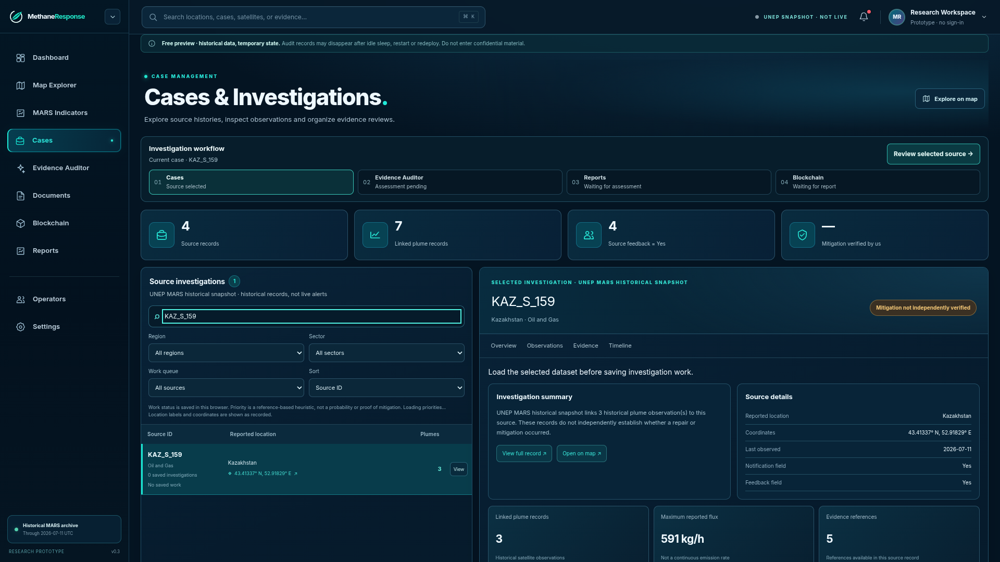
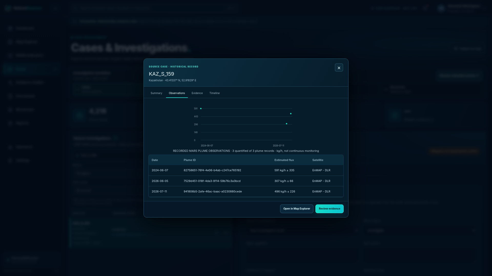
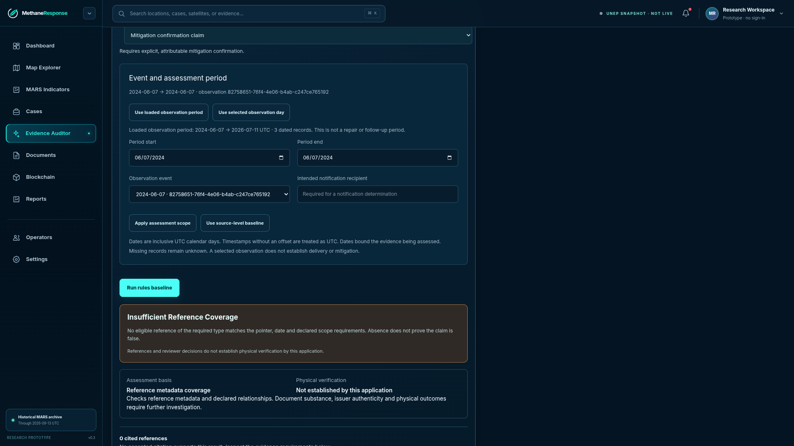
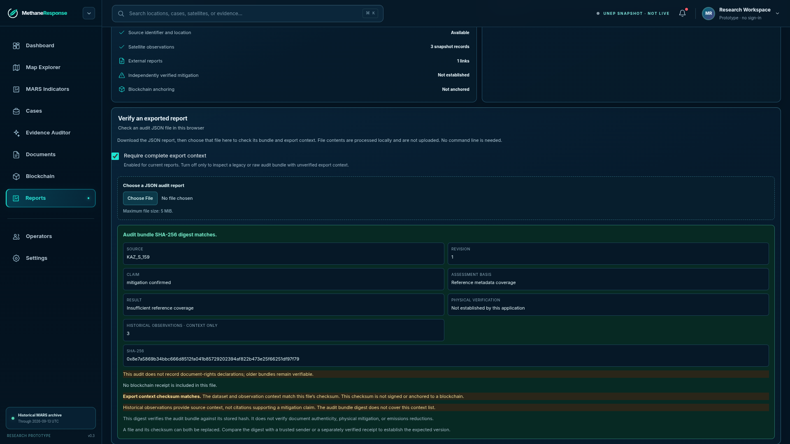

# MethaneResponse

## From methane observations to claims people can inspect

**An evidence-review prototype for tracing what a source record supports, what remains unknown, and what should be checked next.**

> Historical MARS observations · Explicit claim scope · Reproducible rules baseline · Locally verifiable audit digest

## Why this workflow

Satellite alerts, source-level response metadata, operator statements, and evidence about a specific mitigation action are different things. An analyst needs to see which record supports which statement, over what time period, and where the available evidence stops.

MethaneResponse builds on public historical UNEP MARS source and plume metadata. It does not replace MARS detection, notification, or follow-up. It focuses on making a scoped claim review and its supporting references easier to inspect and reproduce.

## Why evidence review matters

UNEP reports that methane has accounted for roughly 30% of global warming since pre-industrial times. The IEA reports that around 12% of MARS notifications received a response in 2025. The latter is a response rate, not a repair or mitigation rate. Together, these facts explain the urgency of methane action and the need to keep detection, response, reported action, and supporting evidence distinct. They do **not** show that MethaneResponse has reduced emissions or improved response rates.

MARS already provides the detection, notification, stakeholder-action and follow-up process. MethaneResponse focuses on a separate review question: for a specific claim and time scope, which records support it, what remains uncertain, and what should be requested next?

## One case, one question

### KAZ_S_159 · Uzen Field, Kazakhstan

The pinned historical snapshot contains three EnMAP observations:

| Observation date (UTC convention used by the app) | Reported source flux | Reported uncertainty |
|---|---:|---:|
| 7 Jun 2024 | 591 kg/h | ±335 kg/h |
| 5 Jun 2026 | 307 kg/h | ±66 kg/h |
| 11 Jul 2026 | 496 kg/h | ±226 kg/h |

These are discrete satellite observations, not continuous monitoring. The casebook records source-level notification and feedback fields; those fields do not identify a recipient or prove repair.

The UNEP catalogue summary for the linked KAZ report states that mitigation action was confirmed in July 2026. The casebook does not provide the exact action date or time. The 11 July observation therefore must not be described as occurring before or after the action.

## What the prototype demonstrates

1. **Explore** a pinned historical source and inspect its record provenance.
2. **Set a date/event scope** before an assessment; the UI keeps unapplied drafts separate.
3. **Run the deterministic rules baseline** against the selected claim and available reference metadata.
4. **Separate outcomes:** the source-detection reference check can pass, while the narrower mitigation claim may remain insufficiently supported in the submitted scope.
5. **Record follow-up** as analyst casework, separate from the audit verdict.
6. **Export and verify** a report locally; changing a hashed audit field causes verification to fail.

## The point is a reviewable boundary

The application can help show what metadata is present and what evidence a reviewer should request next. It cannot establish that a specific operator received a notice, that equipment was physically repaired, or that emissions fell. A missing later observation is unknown, not zero.

The verifier checks the exported bundle against its embedded SHA-256 digest and checks the export-context checksum. Neither check is a public blockchain transaction or an issuer signature; a file and its checksum can both be replaced. Compare a digest against a separately trusted commitment when one exists.

## Product and implementation

- React, TypeScript, Vite and MapLibre for the historical source map and review workflow.
- Bun and Hono for the same-origin preview API.
- A rules baseline with pinned data and reproducible report bundles.
- Browser-side report digest verification.
- A single-service Render Blueprint is prepared as a no-credential, free-tier preview. It is not deployed and uses temporary `/tmp` storage.

No live AI provider, human reviewer authority, persistent database, or blockchain writer is enabled in this preview.

## Sources

- [UNEP MARS data dictionary](https://methanedata.unep.org/dict-mars)
- [UNEP methane and climate explainer](https://www.unep.org/en/news-and-stories/story/methane-emissions-are-driving-climate-change-heres-how-reduce-them)
- [IEA guidance on MARS notifications and 2025 response data](https://www.iea.org/reports/responding-to-satellite-notifications-from-the-methane-alert-and-response-system)
- [How MARS works](https://www.unep.org/en/what-we-do/energy/methane/how-mars-works)
- [UNEP IMEO KAZ report catalogue](https://wedocs.unep.org/handle/20.500.11822/49949)
- MARS casebook provenance and limitations: `data/real/README.md` in the repository.
- Three historical decision cases and method notes: `docs/research/three-historical-decision-cases-2026-10-18.md` in the repository.
- [Source and claim ledger](03-Sources-and-Claims.md)

*Research prototype · historical data · not an authority on physical mitigation*
