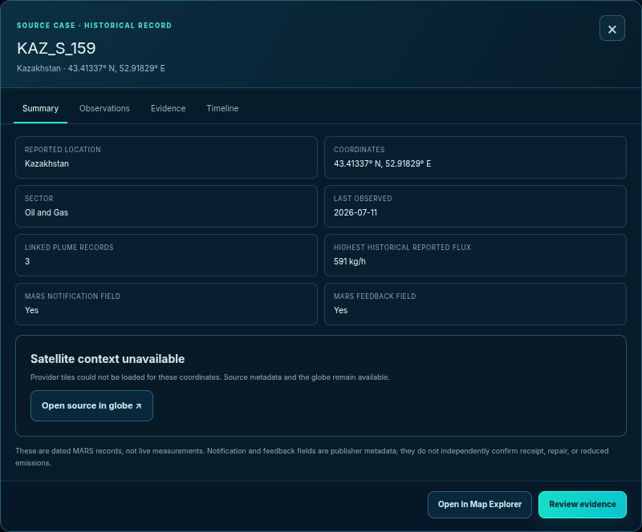
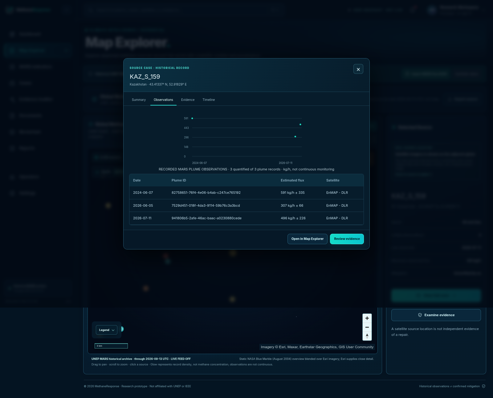
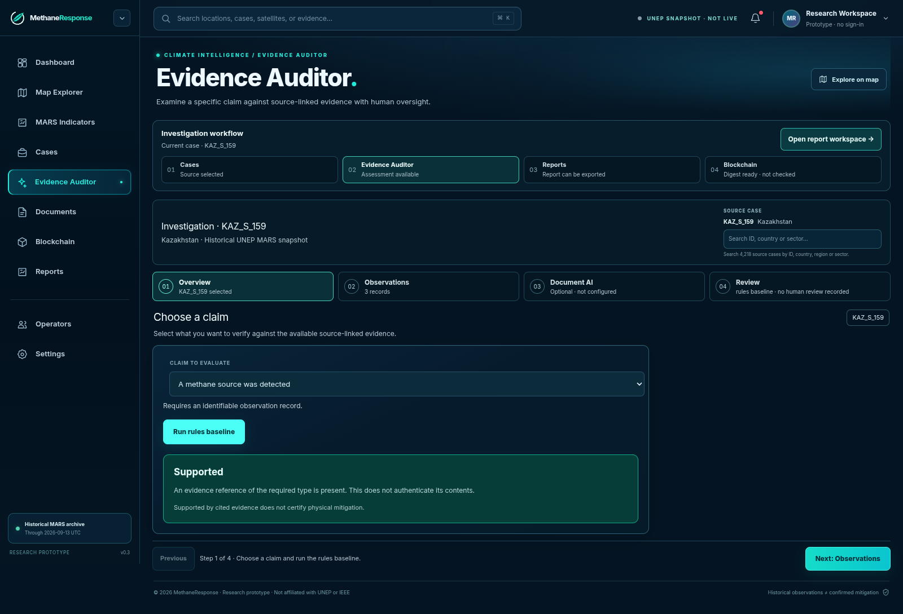
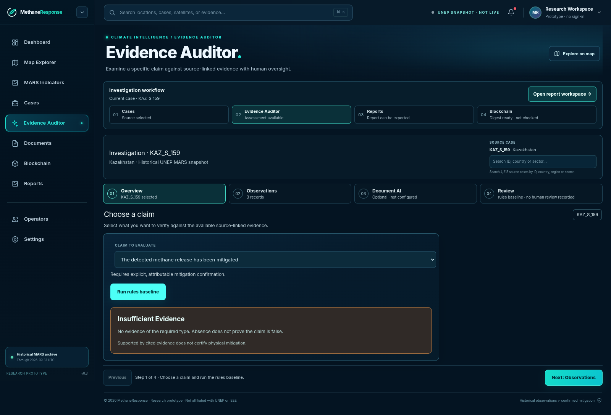
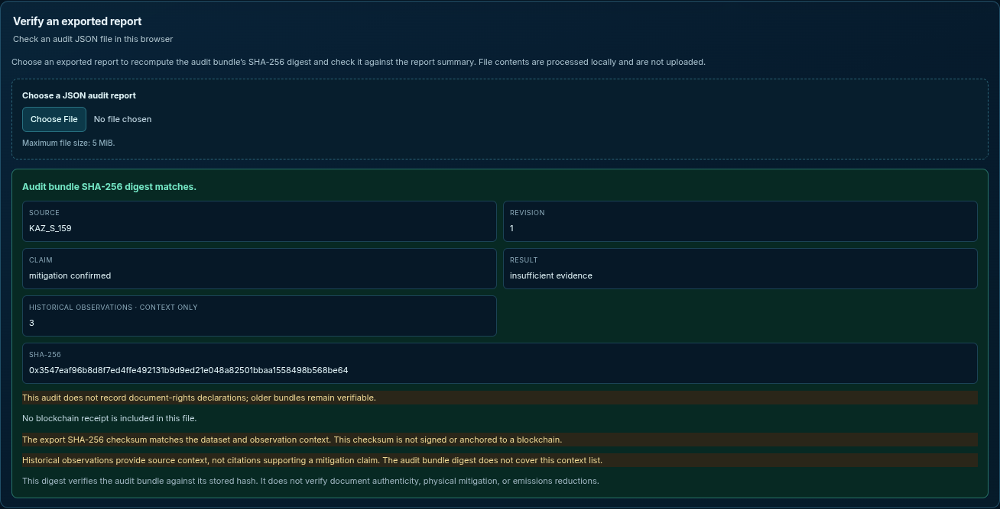
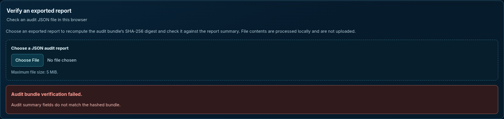

# MethaneResponse

## Evidence Before Claims

**See what supports a claim and what still needs evidence.**

A local research prototype for reviewers working with historical methane alerts.

Historical UNEP MARS data · Deterministic rules · Portable audit records

---

## 01 — A response is the start of a review

For this source, MARS records feedback as **Yes**. Does that confirm mitigation? A reviewer needs evidence for that stronger claim.

**Our question: what does this evidence actually support?**

MethaneResponse keeps the source, dated observations, claim and assessment together.

---

## 02 — Follow one real historical source

**KAZ_S_159 · Kazakhstan · Oil and gas**

The selected MARS snapshot records notification and feedback for this source. Those fields describe administrative activity; they do not establish a physical repair.

Three linked observations. The latest: **11 July 2026, 496 ± 226 kg/h**, EnMAP - DLR.

The ± value is the reported standard deviation. These are discrete historical estimates, not continuous monitoring or a current leak measurement. External basemap requests were blocked for these captures; source metadata and observations remain available.

---

## 03 — Ask a precise question

**Claim: a methane source was detected.**

The rules baseline finds a reference of the required evidence type and returns **supported** within this assessment.

Every result is tied to a claim and the supplied evidence. It is not a general certification of the site.

---

## 04 — A stronger claim needs different evidence

**Claim: mitigation was confirmed. Same source. Same supplied evidence.**

The baseline returns **insufficient evidence**. It identifies the gap instead of treating a response as proof of repair.

An official mitigation-report link exists. Its full contents are not included in this assessment. This result does not contradict that report or establish that mitigation did not happen.

**The demonstrated value: make the evidence gap visible.**

---

## 05 — Carry the review beyond the screen

Export the assessment as a JSON report. Open it in the local Verification Center.

The canonical audit-bundle SHA-256 matches. No blockchain receipt is included.

Changing the bundle without updating its summary makes the verifier reject the report. This example exercises a consistency check before the digest comparison. An unsigned hash can be recomputed; it does not prove authorship or physical truth.

---

## 06 — A focused prototype, with a measurable next step

**Demonstrated:** historical source → observations → claim-specific rules → export → local integrity check.

**Next:** evaluate whether independent reviewers can identify the evidence gap and verify the exported record, using a task-based pilot and manual comparison.

Reviewer time savings, adoption and emissions reductions have not been measured. Live AI evaluation and on-chain anchoring are not part of this walkthrough.

**MethaneResponse makes the evidence and its gaps visible in one review record.**

---

## Sources and scope

Local capture baseline: `a82e2eee99bb79327f859f304f2f5d5939f07041`, 16 October 2026 WITA. Demo data snapshot: `unep-mars-675417694883`, covering 29 October 2020–13 September 2026. Case observations are historical, not synthetic fixtures.

Contains data from UNEP IMEO Eye on Methane / MARS, CC BY-NC-SA 4.0. Changes: normalized source/plume CSV data and rendered a source-focused presentation. Attribution is not endorsement. Linked third-party report contents are not reproduced.

Source provenance, licenses and limitations: [MARS dataset documentation](https://github.com/AndroLay/MethaneResponse/tree/main/data/real). This package is a hackathon proof of concept, not an authoritative monitoring or mitigation certificate.
