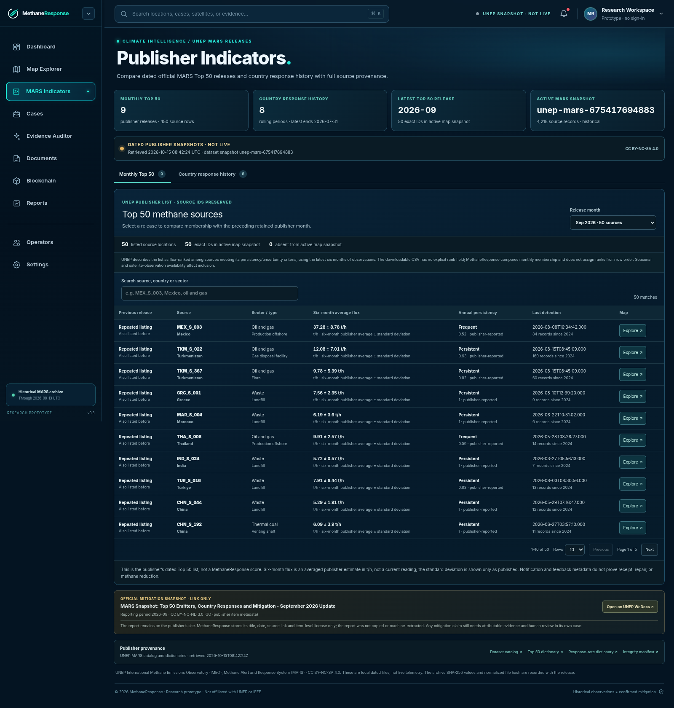
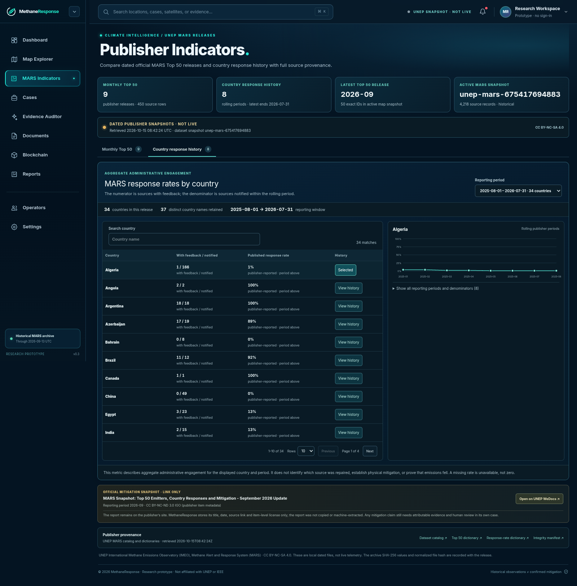

# MARS Indicators — optional appendix

**Use in Q&A or a separate 30-second extension.** Keep the 4:30 core demonstration on KAZ_S_159.

## Publisher context, preserved as published

The Indicators workspace includes nine monthly Top 50 releases, January–September 2026, and eight country response periods. Exact source IDs connect monthly entries to the map snapshot.

Monthly membership is visible. The CSV has no explicit rank field; row order is not presented as rank. Six-month average flux uses the publisher's **t/h** units and reported standard deviation. Individual plume observations in the main demo use **kg/h**; do not compare the displayed numbers without converting units and respecting their different time meanings.

Country response is the fraction of notified sources with feedback for the stated reporting window. Numerators, denominators and dates stay together. Missing values remain unavailable rather than zero. This is administrative engagement, not a repair rate or causal climate outcome.

## Optional click path

1. Open **MARS Indicators** at `/dashboard/indicators?sourceId=KAZ_S_159`.
2. Keep **September 2026** selected. Explain monthly membership and units; do not invent a ranking.
3. Select **Country response history**, set **Rows per page** to 50 and open **View response history for Algeria**.
4. Point to dated windows and numerator/denominator. Return to the main conclusion.

**Say:** “We also preserve publisher context: monthly source-list membership and country feedback histories. Each value retains its reporting period and units. These indicators help orient a review; neither list order nor administrative feedback establishes that a source was repaired.”

## Provenance

Indicators are bound by manifest to snapshot `unep-mars-675417694883`, with nine releases / 450 Top 50 rows and eight windows / 278 country-period rows. The latest country window is 1 August 2025–31 July 2026.

Contains UNEP IMEO MARS data; dataset license CC BY-NC-SA 4.0. Changes: validated archive extraction, normalized fields and dates, exact-ID joins, derived membership comparisons and rendered history. The September mitigation snapshot is a publisher link only; its full contents and mitigation counts are not copied.
