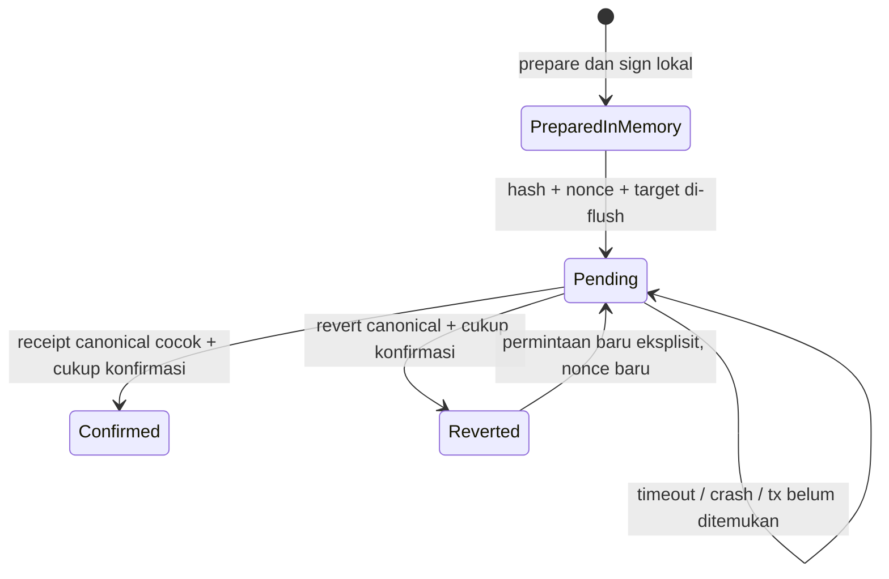

# Anchor dan pemulihan transaksi

[Konfigurasi](configuration.md) · [API](../architecture/api-reference.md) · [ADR](../architecture/decisions/2026-10-17-durable-anchor-intents.md)

## Batas dan status

P2 menyediakan implementasi write/recovery lokal. Bukti transaksi disposable Anvil **bukan** receipt Sepolia publik. Aktivasi signing memerlukan opt-in server; transaksi/deployment publik memerlukan persetujuan target dan operasi. Receipt membuktikan digest, issuer dan kronologi, bukan autentisitas dokumen atau perbaikan fisik metana.

**Keputusan 20 Oktober 2026:** pengguna memilih menyelesaikan blockchain sebagai
prototipe tanpa pendanaan. Jalur penerimaan aktif adalah Anvil lokal di bawah;
Sepolia menjadi demonstrasi publik opsional kemudian. Jangan membeli ETH,
memulai faucet, atau mengklaim receipt publik untuk menutup pekerjaan prototipe.
Anvil menyediakan saldo simulasi hanya pada chain lokal; tidak memerlukan
pendanaan wallet publik.

## Alur operator

1. Jalankan API melalui launcher resmi agar `flock` melindungi satu path state. Gunakan volume lokal yang mendukung `fsync` file/direktori. Satu issuer khusus dipakai hanya oleh instance ini; jangan berbagi key dengan script, wallet atau instance lain.
2. Pilih audit baseline publik yang hash-nya valid. Admin mengotorisasi baseline; reviewer berscope `anchor` terbatas pada schema 3 yang sudah direview dan attestation direktori `operator_attested` yang masih berlaku untuk claim. Token saja tidak cukup; unverified/expired ditolak untuk operasi chain. Schema 4 dan AI belum direview selalu ditolak. Larangan fixture sintetis di production tetap berlaku.
3. Tinjau chain ID, registry, public issuer, audit ID, claim dan bundle hash sebelum persetujuan transaksi. Gunakan registry ber-bytecode `EvidenceRegistry` yang sudah diperiksa. Jumlah test ETH yang dibutuhkan bergantung pada estimasi gas jaringan.
4. Setelah target/operasi disetujui, aktifkan `ENABLE_CHAIN_WRITES=true` pada server. Jangan memasukkan private key atau credential RPC ke browser, `VITE_*`, command history atau repo.
5. Di Verification Center, masukkan credential operator/reviewer yang sesuai. `Check saved transaction` membaca intent lokal. `Anchor current audit` meminta satu transaksi. Konfirmasi UI tetap diperlukan; ini tidak menggantikan persetujuan operator atas target.
6. Jika status pending/timeout, gunakan `Reconcile transaction`. Endpoint hanya membaca chain; tidak menandatangani atau mengirim ulang. Credential hanya berada di memori tab; gunakan Clear credential setelah selesai.
7. Export JSON dan jalankan verifier dari proses lain dengan konfigurasi **read-only** untuk target yang sama:

```sh
bun run verify:audit /path/to/report.json --require-chain
```

`--require-chain` keluar nonzero bila receipt atau konfigurasi jaringan tidak ada. Tanpa flag, checksum offline bisa valid sementara receipt `ABSENT`/`NOT_CHECKED`. `VALID_LATEST` dan `VALID_HISTORICAL` menunjukkan event yang diverifikasi pada saat pemeriksaan; keduanya tidak membuktikan mitigasi.

## State dan pemulihan



- Hash dihitung dari byte transaksi bertanda tangan **sebelum broadcast**. Intent memuat operation/audit/case/claim, bundle hash, chain/registry/issuer, nonce, expected version, waktu dan kebijakan konfirmasi. Byte transaksi bertanda tangan hanya di memori; tidak disimpan, dilog atau dikembalikan API.
- Audit dan intent berada dalam satu envelope JSON. P3 menambahkan `publicationEvents` wajib pada envelope versi 2; baca [migrasi dan batas rollback](publication-lifecycle.md#penyimpanan-dan-kompatibilitas) sebelum mengganti binary atau backup. Reservasi diakui setelah temp file `fsync`, rename dan direktori `fsync`; completion mengubah receipt audit dan intent menjadi confirmed dalam satu penulisan. Array audit legacy dibaca tanpa mengubah bundle/hash dan dimigrasikan pada write berikutnya.
- Marker `.initialized` membedakan store baru dari state hilang. State hilang setelah inisialisasi, marker rusak, JSON rusak, symlink dan mode file terbuka menutup akses. Marker tidak mendeteksi hilangnya seluruh volume, rollback backup lama yang konsisten, atau disk yang tidak menghormati fsync.
- Bila proses mati **sebelum broadcast**, hash tetap diketahui tetapi transaksi mungkin tidak pernah ada di jaringan. `transaction not found` bukan bukti pembatalan: intent tetap pending dan menahan issuer. Tidak ada tombol clear/retry untuk melewati ini. Pulihkan melalui investigasi operator terhadap issuer/nonce dan backup; jangan mengedit intent atau memakai issuer dari instance lain. Prototipe belum menyediakan pembatalan/replacement otomatis.
- Bila proses mati setelah broadcast tetapi sebelum receipt tersimpan, `POST /api/audits/:id/reconcile` mencari hash yang sama lalu memeriksa transaksi dan event. Receipt dari transaksi lain, walaupun hash bundle sama, ditolak. Rekonsiliasi tanpa intent tidak diimpor otomatis; gunakan verifier independen untuk receipt legacy.
- Revert yang canonical dan cukup konfirmasi mengakhiri attempt tanpa menandai audit anchored. Permintaan baru harus eksplisit dan memakai nonce baru. Riwayat attempt lama dipertahankan.
- Default konfirmasi **2 block**; `CHAIN_CONFIRMATIONS` menerima 1–64. Pemeriksaan memakai nilai terbesar antara policy verifier saat ini dan policy receipt/intent. Ini inclusion confidence, bukan finalitas Ethereum. Reorg setelah completion dapat membuat `/verify` menolak receipt; metadata historis tidak dihapus. Tidak ada watcher reorg otomatis atau jaminan finalitas.
- Target chain/registry yang berubah ketika intent belum selesai tidak membatalkan intent. Kembalikan konfigurasi yang cocok untuk rekonsiliasi. Key tidak dibutuhkan untuk rekonsiliasi atau verifier.

## Menjalankan pemeriksaan lokal

```sh
bun --no-env-file test apps/api/src/anchor-store.test.ts apps/api/src/anchor-intent.test.ts apps/api/src/anchor-idempotency.test.ts apps/api/src/anchor-authority.test.ts apps/api/src/chain-recovery.test.ts apps/api/src/chain.test.ts scripts/verify-audit.test.ts
bun run test:chain-integration
```

Integration runner menyaring environment dan menonaktifkan `.env`, membangun kontrak dengan Forge, lalu menjalankan Anvil loopback chain **31337** memakai signer acak disposable. Ia menguji `SIGKILL` sebelum/sesudah broadcast, rekonsiliasi, revert, revisi historis dan verifier CLI terpisah dengan report yang dimodifikasi. Tidak memanggil Sepolia/provider publik. `anvil`, `forge` dan izin socket lokal diperlukan.

Ini merupakan jalur testing tanpa faucet, wallet Mainnet atau pembelian ETH. Opsional: `bun run test:chain-integration --evidence /tmp/methane-local-receipt-baru.json` menyimpan receipt ke path yang belum ada. Chain dihentikan setelah tes; receipt lokal bukan tautan explorer publik. [Hasil pengulangan 17 Oktober](../evidence/p2-local-testing-2026-10-17/README.md): 31 tes terfokus dan satu skenario integrasi lulus. Jalur lokal dapat dipakai sambil item transaksi Sepolia pada rencana awal tetap belum terpenuhi.

Backup/restore harus mencakup audit envelope, marker, state casework dan markernya di bawah writer lock. [Runbook P1](shared-casework.md) menjelaskan alat backup casework; alat tersebut **belum** merupakan backup lengkap audit/intent P2. Jangan mengganti hanya envelope dengan backup lama: nonce dan intent confirmed bisa hilang. Desain ini dibatasi satu writer lokal, bukan failover multi-instance.

Pencabutan direktori diperiksa pada awal operasi dan sebelum reservasi/penyelesaian yang relevan. Pencabutan persis setelah pemeriksaan terakhir dapat berpacu dengan broadcast; direktori eksternal dan jaringan blockchain tidak berada dalam transaksi atomik yang sama. Completion transaksi yang sudah disiarkan tetap dapat dicatat oleh operator yang berwenang.
