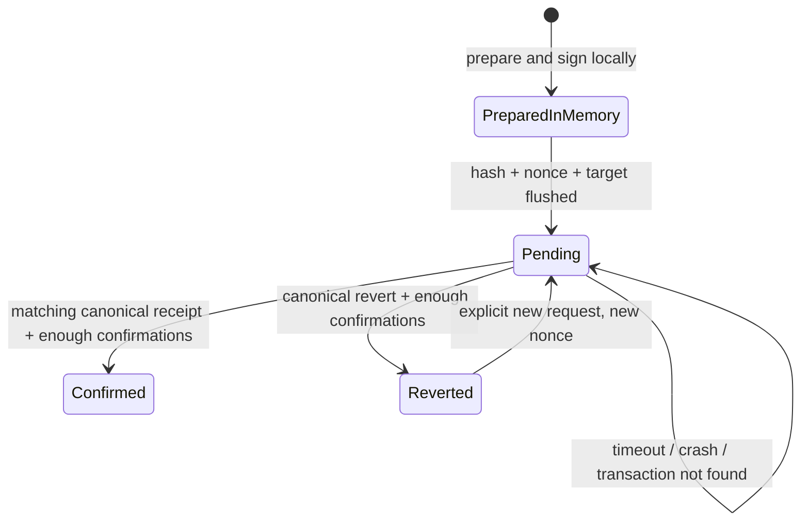

# Anchoring and transaction recovery

[Configuration](configuration.md) · [API](../architecture/api-reference.md) · [ADR](../architecture/decisions/2026-10-17-durable-anchor-intents.md)

## Scope and status

P2 provides local write and recovery implementations. Disposable Anvil transaction evidence is **not** a public Sepolia receipt. Enabling signing requires server opt-in; public transactions/deployments require approval of the target and operation. A receipt proves a digest, issuer, and chronology, not document authenticity or physical methane mitigation.

**Decision on 20 October 2026:** the user chose to complete blockchain as an unfunded prototype. The active acceptance path is local Anvil below; Sepolia may be used for an optional public demonstration later. Do not buy ETH, start a faucet, or claim a public receipt to complete prototype work. Anvil provides simulated funds only on its local chain; no public wallet funding is required.

## Operator workflow

1. Start the API through the official launcher so `flock` protects a single state path. Use a local volume that supports file/directory `fsync`. A dedicated issuer must be used only by this instance; do not share its key with a script, wallet, or another instance.
2. Select a public baseline audit with a valid hash. An admin authorizes the baseline; a reviewer scoped to `anchor` is limited to reviewed schema 3 and a current `operator_attested` directory attestation for the claim. A token alone is insufficient; unverified/expired subjects are rejected for chain operations. Schema 4 and AI that have not been reviewed are always rejected. The production ban on synthetic fixtures still applies.
3. Review the chain ID, registry, public issuer, audit ID, claim, and bundle hash before approving the transaction. Use a registry with inspected `EvidenceRegistry` bytecode. The required amount of test ETH depends on the network's gas estimate.
4. After the target and operation are approved, set `ENABLE_CHAIN_WRITES=true` on the server. Do not put a private key or RPC credential in the browser, `VITE_*`, command history, or repository.
5. In Verification Center, enter the appropriate operator/reviewer credential. **Check saved transaction** reads the local intent. **Anchor current audit** requests one transaction. UI confirmation is still required; it does not replace operator approval of the target.
6. If the status is pending/timeout, use **Reconcile transaction**. The endpoint only reads the chain; it does not sign or resend. Credentials remain only in tab memory; use **Clear credential** when finished.
7. Export JSON and run the verifier from a separate process with **read-only** configuration for the same target:

```sh
bun run verify:audit /path/to/report.json --require-chain
```

`--require-chain` exits nonzero if a receipt or network configuration is missing. Without the flag, the offline checksum may be valid while the receipt is `ABSENT`/`NOT_CHECKED`. `VALID_LATEST` and `VALID_HISTORICAL` indicate events verified at check time; neither proves mitigation.

## State and recovery



- The hash is calculated from the signed transaction bytes **before broadcast**. The intent contains the operation/audit/case/claim, bundle hash, chain/registry/issuer, nonce, expected version, time, and confirmation policy. Signed transaction bytes exist only in memory; they are not stored, logged, or returned by the API.
- The audit and intent are kept in one JSON envelope. P3 adds required `publicationEvents` to envelope version 2; read [migration and rollback limits](publication-lifecycle.md#storage-and-compatibility) before replacing the binary or backup. A reservation is acknowledged after the temp file is fsynced, renamed, and its directory fsynced; completion updates the audit receipt and intent to confirmed in one write. A legacy audit array is read without changing its bundle/hash and is migrated on the next write.
- The `.initialized` marker distinguishes a new store from missing state. Missing state after initialization, a corrupt marker, corrupt JSON, symlinks, and permissive file modes fail closed. The marker does not detect loss of the entire volume, a consistent rollback to an old backup, or a disk that does not honor `fsync`.
- If the process stops **before broadcast**, the hash remains known, but the transaction may never have reached the network. `transaction not found` does not prove cancellation: the intent remains pending and holds the issuer. There is no clear/retry button to bypass this. Recover by investigating the issuer/nonce and backups as an operator; do not edit the intent or use an issuer from another instance. The prototype does not provide automatic cancellation/replacement.
- If the process stops after broadcast but before storing the receipt, `POST /api/audits/:id/reconcile` looks for the same hash, then checks the transaction and event. A receipt from another transaction is rejected even if its bundle hash matches. Reconciliation without an intent is not imported automatically; use the independent verifier for a legacy receipt.
- A canonical revert with enough confirmations ends the attempt without marking the audit as anchored. A new request must be explicit and use a new nonce. The old attempt remains in the history.
- The default is **2 blocks** of confirmation; `CHAIN_CONFIRMATIONS` accepts 1–64. The check uses the larger value of the current verifier policy and the receipt/intent policy. This is inclusion confidence, not Ethereum finality. A reorg after completion may cause `/verify` to reject the receipt; historical metadata is not removed. There is no automatic reorg watcher or finality guarantee.
- Changing the chain/registry target while an intent is incomplete does not cancel the intent. Restore the matching configuration to reconcile it. A key is not needed for reconciliation or verification.

## Running local checks

```sh
bun --no-env-file test apps/api/src/anchor-store.test.ts apps/api/src/anchor-intent.test.ts apps/api/src/anchor-idempotency.test.ts apps/api/src/anchor-authority.test.ts apps/api/src/chain-recovery.test.ts apps/api/src/chain.test.ts scripts/verify-audit.test.ts
bun run test:chain-integration
```

The integration runner filters the environment and disables `.env`, builds the contract with Forge, then runs an Anvil loopback chain **31337** with a disposable random signer. It tests `SIGKILL` before/after broadcast, reconciliation, reverts, historical revisions, and a separate verifier CLI using a modified report. It does not call Sepolia or a public provider. `anvil`, `forge`, and local socket permission are required.

This is a testing path without a faucet, Mainnet wallet, or ETH purchase. Optional: `bun run test:chain-integration --evidence /tmp/methane-local-receipt-new.json` saves a receipt to a path that does not yet exist. The chain stops after the test; a local receipt is not a public explorer link. [The 17 October rerun result](../evidence/p2-local-testing-2026-10-17/README.md): 31 focused tests and one integration scenario passed. The local path can be used while the Sepolia transaction item in the initial plan remains incomplete.

Backup/restore must include the audit envelope, marker, casework state, and its marker under the writer lock. The [P1 runbook](shared-casework.md) describes casework backup tools; those tools are **not** a complete backup of the P2 audit/intent. Do not replace only the envelope with an old backup: the nonce and confirmed intent could be lost. This design is limited to one local writer, not multi-instance failover.

Directory revocation is checked at the start of an operation and before relevant reservation/completion steps. Revocation immediately after the last check can race with broadcast; the external directory and blockchain network are not part of the same atomic transaction. An authorized operator may still record completion of a transaction that has already been broadcast.
