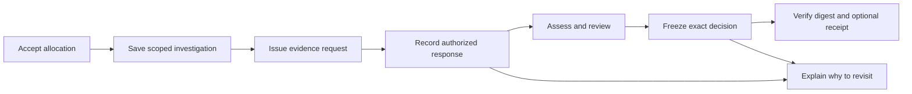

# Connected Investigations — 20 October 2026

Investigation allocation, evidence, follow-up requests, review, frozen decisions, and revisit checks share one source/snapshot/scope context. This is a local prototype implementation without new databases/dependencies. [User/operations guide](../../development/connected-investigations.md) · [API](../../architecture/api-reference.md) · [Plan](../../plans/2026-10-20-connected-investigations.md).

Git baseline: `8e19c034e666a6b00d93b4cb3f5747f563c75aab`; results came from an uncommitted working tree. `source-manifest.json` records inspected source bytes: the baseline commit alone does not represent this increment. `checks.json` records runs/limits; `artifact-manifest.json` binds package files. Manifests are not independent signatures.

## Integrated workflow



| Capability | Implementation/check | Boundary |
|---|---|---|
| Plan → investigation | Exact accepted revision, source membership, snapshot/archive/replay; private API/browser | Historical approval, not a current mandate or measured climate benefit |
| Source/claim/scope continuity | Immutable work identity, saved history, CAS, stale-response guard | Different claim/scope requires a new work ID |
| Request/response/review | Append-only typed events, role/deadline, original SHA-256, rights declaration, day/month/year/unknown precision | Stored events; no automatic email/download/AI. Hashes/rights are not authenticated |
| Assessment | Reuses immutable baseline/human/model bundles, exact relationships, quote checks | Optional AI; deterministic E2E providers are not real-model benchmarks |
| Frozen decision | Exact verified dossier, rationale/reviewer/time, revision ancestry, current authority/CAS | DEMO software review is not a human pilot or repair confirmation |
| Revisit | New responses/reviews, changed criteria/assessments, matching next-snapshot records, context notices | Does not rewrite historical determinations or turn a newer archive into live monitoring |
| Independent verifier | Canonical SHA-256, separately trusted digest, relationship/replay checks | Self-supplied checksums do not authenticate; JSON formatting may normalize |
| Blockchain | Actual Anvil contract/events, independent CLI, shared legacy/new nonce coordination, lost-ack recovery | Disposable chain 31337, not Sepolia, a public receipt, or physical truth |
| UI | Private workspace, explicit saves/approvals, responsive controls, empty/error/loading/conflict states | Mobile viewport/software WebGL, not physical-phone/FPS measurement |

Main code: [shared decision/dossier](../../../packages/shared/src/investigation-decision.ts), [durable decision routes](../../../apps/api/src/investigation-decision-routes.ts), [workspace](../../../apps/web/src/InvestigationContextPanel.tsx), [independent verifier](../../../scripts/verify-investigation-decision.ts). Historical contracts/bundle hashes were not rewritten.

## Actual evidence and recorded runs

[checks.json](checks.json) records final counts/exit codes. Main gates cover frozen install, API/web/E2E/evaluation typecheck, API/web/tooling tests, production build/budget, Python, baseline conformance, and Foundry. Browser/crash/chain operations ran separately; focused repeats are not extra coverage.

| Final check | Recorded result |
|---|---|
| API / web / tooling / Python / Foundry | 284 / 275 / 58 / 221 / 4 — **842 tests**, no failures/skips |
| Main / private-team E2E | 28 / 12 — **40 checks**: 39 browser journeys and one Node schema check, no failures/retries/skips |
| Separate operations | One actual Anvil integration; two casework and one publication crash/restart |
| Retained-export CLI | Eleven expected exit outcomes, including rejection and trust-boundary controls |
| App entry | 74,667/75,000 gzip bytes; eight required lazy route chunks passed |
| Prior evidence | 98 artifacts from five earlier packages matched original manifests |

Complete gates were also repeated in a source copy without `node_modules`: **137 dependency packages installed frozen/offline from local cache**, then all 842 tests/typechecks/build/budget passed. **414 runtime/config/data-input files** matched active source byte-for-byte. An earlier fresh-cache download was stopped for slowness (exit 143), not claimed successful. This establishes cached installation, not all downloads on a fresh network. Active documentation was completed after the code copy.

- `checks-output.txt`: complete local gate log.
- `browser-private-output.txt`, `browser-main-output.txt`: separate phases, fresh production frontend, one worker, no retries.
- `anvil-output.txt`, `anvil-proof.json`: actual local contract, not a mock receipt; complete frozen decision retained.
- `casework-operations-output.txt`, `publication-operations-output.txt`: backup/lock/restore and actual API SIGKILL/restart.
- `clean-install-output.txt`, `clean-checks-output.txt`, `clean-network-interrupted.txt`: cached install, copied-source gates, interrupted download.
- [Review/fixes](review-notes.md): privacy, normalization, reconciliation, revisit, and two corrected team-test assumptions.
- `prior-manifests.json`: 98 earlier artifacts checked; original evidence bytes were not overwritten.

### Browser case

Real historical source **TKM_S_021**, snapshot `unep-mars-675417694883`, 4,218 source/30,414 plume rows. A **DEMO software** reviewer accepted allocation and saved questions/requests, then a human-path `insufficient_evidence` assessment as a workflow fixture. No human expert assessed this case.

The initial export contains three work revisions, one plan, one snapshot comparison, one assessment. The frozen decision retains five revisions/three evidence events, including document date **`2026-09` with `month` precision**, without inventing a day. A later response triggers `new_authorized_response`; the frozen decision is unchanged. A historical comparison already included in its snapshot is `already_in_decision_snapshot`.

- [Desktop decision](decision-desktop.png).
- [Desktop investigation](connected-investigation-desktop.png).
- [Mobile viewport 390×844](connected-investigation-mobile.png).
- [Initial dossier](proof/connected-investigation.json), [frozen browser decision](proof/browser-frozen-decision.json).

Browser checks cover refresh/revision conflict, cross-origin digest exposure only to authorized reviewers, stale results after revision changes, no page errors/overflow on this journey, and token-free exports. External imagery was blocked; captures do not establish live satellite-imagery quality.

### Anvil and checksum evidence

The [decision actually anchored locally](proof/local-chain-decision.json) uses real historical source **KAZ_S_159**, scoped `source_detected`, with a DEMO software reviewer. Assessment checks metadata coverage, not physical repairs.

While Anvil ran, a separate CLI accepted the original, rejected altered rationale **even with a newly supplied expected checksum**, accepted the original again, then recognized it as historical after a later anchor revision. Lost-ack recovery retained a durable intent and consumed only one nonce. Audit/decision paths blocked each other while an intent was pending.

`proof/offline-decision-verification.json` records seven CLI calls after chain shutdown. Original → altered → altered+rehash → original were checked against the original commitment. A negative control shows that an attacker replacing **both file and supplied digest** can pass local checks. The digest therefore needs a trusted channel; actual chain checks rejected the change during integration.

## Reproduce from matching source

Prerequisites: Bun, Python/uv with locked research extras, Foundry/Anvil, Linux `flock`, and Chromium with local sandbox/socket access. From repository root:

```bash
bun install --frozen-lockfile
bun run check:all
PLAYWRIGHT_CHROMIUM_EXECUTABLE=/usr/bin/chromium bun run test:e2e
bun run test:case-work-operations
bun run test:publication-operations
bun run test:chain-integration --evidence /tmp/NEW-anvil-proof.json
```

Adjust Chromium's path for the host. The Anvil evidence path must not exist. The runner does not use development state, real RPC/signers, or inherited provider credentials. [Local setup](../../development/local-setup.md) and [reviewer governance](../../development/connected-investigations.md) apply to manual operation; fixtures do not create real reviewers.

`proof/trusted-digests.json` records artifact pins. Verify exports against separately recorded digests:

```bash
bun run verify:investigation docs/evidence/connected-investigations-2026-10-20/proof/connected-investigation.json --expected-digest 0xTRUSTED_DOSSIER_DIGEST
bun run verify:investigation-decision docs/evidence/connected-investigations-2026-10-20/proof/local-chain-decision.json --expected-digest 0xTRUSTED_DECISION_DIGEST
```

Replace placeholders with correct 64-digit digests. Add `--require-chain` only with the matching receipt and available read-only RPC/registry. Test Anvil was stopped; local addresses/transactions are not public explorer links. Reruns create new accounts, deployments, digests, and receipts.

## Limits and next steps at this checkpoint

- No new external AI-provider/independent labeled-benchmark results, human/expert pilot, public deployment, or Sepolia receipt.
- No claim of superiority, time savings, repair probability, emission reduction, or guaranteed competition success.
- Private file state remains single-writer. Envelope 3 needs a decision-aware writer; guides describe backup/rollback. Public preview excludes private dossiers/decisions.
- Earlier videos/judging packs remain bound to their original runtime revisions. This is new coding evidence, not proof that old footage shows every new workflow or that submission occurred.
- Next: align demo material with publishable source; verify authorized public CI/deployment; evaluate licensed AI and user benefits as separate studies.
