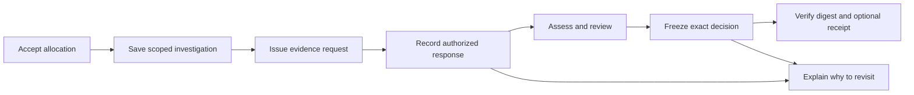

# Connected Investigations — 20 Oktober 2026

Alokasi investigasi, bukti, permintaan tindak lanjut, review, keputusan beku dan pemeriksaan ulang kini memakai satu konteks sumber/snapshot/scope. Ini hasil implementasi prototipe lokal, tanpa database/dependensi baru. [Panduan pengguna dan operasi](../../development/connected-investigations.md) · [API](../../architecture/api-reference.md) · [Rencana](../../plans/2026-10-20-connected-investigations.md).

Baseline Git `8e19c034e666a6b00d93b4cb3f5747f563c75aab`; hasil berasal dari working tree yang belum di-commit. `source-manifest.json` mencatat byte source yang diperiksa; SHA commit baseline saja tidak mewakili increment ini. `checks.json` mencatat setiap run beserta batasnya, dan `artifact-manifest.json` mengikat berkas paket ini. Manifest bukan tanda tangan pihak independen.

## Yang benar-benar terintegrasi



| Kemampuan | Implementasi dan pemeriksaan | Batas |
|---|---|---|
| Plan → investigation | Exact accepted revision, source membership, snapshot/archive and replay; private API + browser | Persetujuan historis, bukan mandat terkini atau manfaat iklim terukur |
| Source/claim/scope continuity | Immutable work identity, saved history, CAS dan stale-response guard | Perubahan claim/scope memerlukan work ID baru |
| Request/response/review | Append-only typed events, peran/tenggat, SHA-256 asli, rights declaration, day/month/year/unknown | Event disimpan; tidak ada email/download/AI otomatis. Hash/rights belum diautentikasi |
| Assessment | Reuse immutable baseline/human/model bundles, exact relations and quote checks | AI opsional; provider deterministik pada E2E bukan benchmark model nyata |
| Frozen decision | Copy exact verified dossier, rationale/reviewer/time, revision ancestry, current authority/CAS | Review software DEMO dalam tes bukan pilot manusia atau konfirmasi repair |
| Revisit | New response/review, criteria/assessment changes, matching next-snapshot records dan context notices | Tidak mengubah determination historis atau menganggap arsip terbaru sebagai live feed |
| Independent verifier | Canonical SHA-256, separately trusted digest, internal relationship/replay checks | Self-supplied checksum bukan autentikasi; formatting JSON dapat dinormalisasi |
| Blockchain | Actual Anvil contract/event, independent CLI, legacy/new nonce coordinator, lost-ack recovery | Chain 31337 disposable; bukan Sepolia, receipt publik atau fakta fisik |
| UI | Private workspace, explicit saves/approvals, responsive controls, empty/error/loading/conflict states | Viewport mobile dan software WebGL; bukan HP fisik atau pengukuran FPS |

Kode utama: [shared decision/dossier](../../../packages/shared/src/investigation-decision.ts), [durable decision routes](../../../apps/api/src/investigation-decision-routes.ts), [workspace](../../../apps/web/src/InvestigationContextPanel.tsx), [independent verifier](../../../scripts/verify-investigation-decision.ts). Tidak ada rewrite kontrak atau hash bundle historis.

## Bukti aktual dan hasil run

Hasil final, hitungan dan exit code dicatat di [checks.json](checks.json). Gate utama meliputi frozen install, API/web/E2E/evaluation typecheck, API/web/tooling tests, production build/budget, Python, baseline conformance dan Foundry. Browser serta operasi crash/chain dijalankan terpisah; focused repeats tidak dijumlahkan sebagai coverage baru.

| Pemeriksaan final | Hasil aktual |
|---|---|
| API / web / tooling / Python / Foundry | 284 / 275 / 58 / 221 / 4 — **842 tes**, tanpa fail/skip |
| Main / private-team E2E | 28 / 12 — **40 pemeriksaan**: 39 browser journeys dan satu Node schema check, tanpa fail/retry/skip |
| Operasi terpisah | Satu actual Anvil integration; dua casework dan satu publication crash/restart |
| Retained export CLI | 11 skenario dengan exit code sesuai harapan, termasuk expected rejection dan kontrol batas trust |
| App entry | 74.667/75.000 byte gzip; delapan required lazy route chunks lulus |
| Bukti lama | 98 artefak dari lima paket sebelumnya cocok dengan manifest asal |

Gate lengkap juga diulang pada salinan source tanpa `node_modules`: **137 dependency packages dipasang secara frozen/offline dari cache lokal**, lalu seluruh 842 tes/typecheck/build/budget lulus. Sebanyak **414 berkas runtime/config serta input data** cocok byte-per-byte dengan source aktif. Percobaan fresh-cache download sebelumnya dihentikan karena lambat (exit 143); hasil itu tidak diklaim lulus. Bukti ini memverifikasi instalasi berbasis cache, bukan keberhasilan mengunduh seluruh dependency pada jaringan baru. Dokumentasi aktif diselesaikan setelah salinan kode dibuat.

- `checks-output.txt`: full local gate log.
- `browser-private-output.txt` dan `browser-main-output.txt`: masing-masing phase dengan production frontend baru, satu worker, tanpa retries.
- `anvil-output.txt` dan `anvil-proof.json`: kontrak lokal aktual, bukan mock RPC receipt. Full frozen decision juga dipertahankan.
- `casework-operations-output.txt` dan `publication-operations-output.txt`: backup/lock/restore dan actual API SIGKILL/restart.
- `clean-install-output.txt`, `clean-checks-output.txt` dan `clean-network-interrupted.txt`: instalasi cache, gate pada salinan source, dan percobaan jaringan yang dihentikan.
- [Review dan koreksi](review-notes.md): privacy/normalization/reconcile/revisit serta dua asumsi tes tim yang diperbaiki.
- `prior-manifests.json`: pemeriksaan 98 artefak pada lima paket sebelumnya. Byte evidence lama tidak ditimpa.

### Kasus browser

Real historical source **TKM_S_021**, snapshot `unep-mars-675417694883`, 4.218 source/30.414 plume rows. Reviewer bertanda **DEMO software** menerima alokasi dan menyimpan pertanyaan/permintaan, lalu assessment human-path `insufficient_evidence` sebagai fixture workflow. Tidak ada ahli manusia yang menilai kasus tersebut.

Ekspor awal memiliki tiga revisi pekerjaan, satu plan, satu perbandingan snapshot dan satu assessment. Keputusan beku menyimpan lima revisi dan tiga evidence events, termasuk tanggal dokumen **`2026-09` dengan precision `month`**, tanpa hari palsu. Respons berikutnya memicu `new_authorized_response`; frozen decision tetap sama. Perbandingan snapshot historis yang sudah termasuk snapshot keputusan diberi status `already_in_decision_snapshot`.

- [Desktop decision](decision-desktop.png).
- [Desktop investigation](connected-investigation-desktop.png).
- [Mobile viewport 390×844](connected-investigation-mobile.png).
- [Dossier awal](proof/connected-investigation.json) dan [keputusan beku browser](proof/browser-frozen-decision.json).

Browser menguji refresh/revision conflict, cross-origin digest exposure hanya bagi reviewer berwenang, stale result setelah perubahan revisi, tidak adanya page error/overflow pada journey ini dan tidak adanya token pada ekspor. External imagery diblokir; capture tidak membuktikan kualitas citra satelit live.

### Bukti Anvil dan checksum

[Keputusan yang benar-benar di-anchor secara lokal](proof/local-chain-decision.json) menggunakan real historical source **KAZ_S_159**, scoped `source_detected`, software reviewer DEMO. Assessment memeriksa cakupan metadata sumber; tidak menilai perbaikan fisik.

Saat Anvil masih berjalan, CLI proses terpisah menerima original, menolak rationale yang diubah **bahkan dengan checksum baru yang diberikan sebagai expected digest**, menerima original kembali, lalu mengenali original sebagai historical setelah anchor revisi berikutnya. Recovery kehilangan acknowledgement meninggalkan durable intent dan hanya mengonsumsi satu nonce; jalur audit dan decision saling memblokir saat ada pending intent.

`proof/offline-decision-verification.json` mencatat tujuh pemanggilan CLI setelah chain dihentikan. Original → altered → altered+rehash → original diperiksa terhadap commitment awal. Kontrol negatif juga menunjukkan bahwa penyerang yang mengganti **berkas sekaligus supplied digest** dapat lolos pemeriksaan lokal. Inilah alasan digest harus datang dari kanal tepercaya; pengecekan chain yang aktual menolak perubahan tersebut saat integrasi berjalan.

## Reproduksi dari source yang cocok

Toolchain perlu tersedia: Bun, Python/uv dengan locked research extras, Foundry/Anvil, Linux `flock` dan Chromium yang dapat memakai sandbox/socket lokal. Jalankan dari root repo:

```bash
bun install --frozen-lockfile
bun run check:all
PLAYWRIGHT_CHROMIUM_EXECUTABLE=/usr/bin/chromium bun run test:e2e
bun run test:case-work-operations
bun run test:publication-operations
bun run test:chain-integration --evidence /tmp/NEW-anvil-proof.json
```

Ganti path Chromium sesuai host. Path evidence Anvil harus belum ada. Runner tidak memakai development state, real RPC/signer atau inherited provider credentials. Untuk operasi manual, [setup lokal](../../development/local-setup.md) dan [reviewer governance](../../development/connected-investigations.md) tetap berlaku; jangan membuat reviewer nyata dari fixture.

Digest tepercaya per artefak tercatat pada `proof/trusted-digests.json`. Periksa ekspor menggunakan digest yang telah dicatat terpisah:

```bash
bun run verify:investigation docs/evidence/connected-investigations-2026-10-20/proof/connected-investigation.json --expected-digest 0xTRUSTED_DOSSIER_DIGEST
bun run verify:investigation-decision docs/evidence/connected-investigations-2026-10-20/proof/local-chain-decision.json --expected-digest 0xTRUSTED_DECISION_DIGEST
```

Ganti placeholder dengan digest 64 digit yang benar. Tambahkan `--require-chain` hanya dengan receipt dan read-only RPC/registry yang tepat dan masih tersedia. Anvil dari tes telah dihentikan; alamat/tx lokal bukan tautan explorer publik. Menjalankan ulang menghasilkan akun, deployment, digest dan receipt baru.

## Batas dan pekerjaan berikutnya

- Belum ada hasil baru provider AI eksternal/benchmark berlabel independen, pilot manusia/pakar, deployment publik atau receipt Sepolia pada increment ini.
- Tidak ada klaim keunggulan atas proyek lain, penghematan waktu, probabilitas repair, pengurangan emisi, atau jaminan menang.
- Tetap satu writer dengan private file state. Envelope 3 memerlukan writer yang memahami keputusan; backup/rollback dijelaskan pada panduan. Public preview tidak membuka dossier/keputusan privat.
- Video/judging pack lama tetap terikat revisi runtime asal. Paket ini adalah bukti coding baru, bukan pernyataan bahwa video lama sudah memperagakan seluruh workflow baru atau submission telah dikirim.
- Prioritas selanjutnya: sinkronkan materi demo dengan source yang siap dipublikasikan; verifikasi CI/deployment pada target publik bila diizinkan; evaluasi AI berizin dan manfaat pengguna sebagai studi terpisah.
