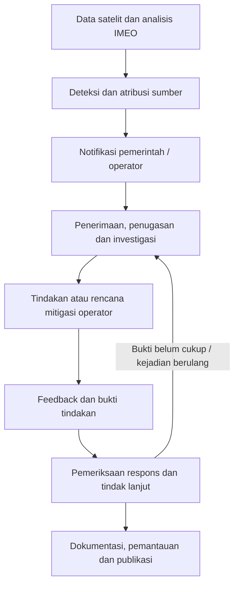

# Alur MARS dan peran MethaneResponse

Pemetaan implementasi diperbarui 18 Oktober 2026; halaman sumber primer diperiksa kembali pada tanggal tersebut. MARS adalah layanan UNEP International Methane Emissions Observatory (IMEO).

## Alur resmi dari awal sampai akhir

UNEP membaginya menjadi empat komponen:

1. **Detect & Attribute:** deteksi satelit dianalisis dan diatribusikan ke sumber menggunakan informasi yang tersedia.
2. **Notify & Engage:** IMEO memberi tahu pemerintah dan operator melalui jalur yang berlaku, lalu melanjutkan komunikasi.
3. **Stakeholders Take Action:** pemerintah/operator menginvestigasi, menentukan respons, dan melaporkan tindakan.
4. **Track, Collaborate & Learn:** IMEO memantau perkembangan, mendukung tindak lanjut dan pembelajaran, serta memublikasikan data.

Sumber: [UNEP — How MARS works](https://www.unep.org/en/what-we-do/energy/methane/how-mars-works).

Untuk respons pemerintah, panduan IEA–IMEO merinci lima langkah: menerima/menugaskan/mengklasifikasikan notifikasi → memberi tahu operator → memperoleh respons operator → memverifikasi respons dan tindak lanjut → meninjau dan mendokumentasikan kasus. Ini pedoman operasional yang dapat disesuaikan, bukan jaminan semua kejadian selesai pada tenggat yang sama.

Sumber: [IEA–IMEO, 4 Mei 2026](https://www.iea.org/reports/responding-to-satellite-notifications-from-the-methane-alert-and-response-system).

Feedback menunjukkan respons yang tercatat. Ketiadaan plume berikutnya bukan bukti nol emisi: keterbatasan cakupan, cuaca, dan sensitivitas satelit tetap berlaku. Bukti tindakan dan pemeriksaan tindak lanjut perlu dibedakan dari status administratif.

Sumber: [IMEO — Eye on Methane FAQ](https://methanedata.unep.org/frequently-asked-questions).

## Pemetaan produk

Pemetaan berikut adalah keputusan desain MethaneResponse untuk investigasi data historis publik, bukan pernyataan integrasi resmi dengan MARS.

| Kebutuhan investigasi | Dukungan produk | Batas |
|---|---|---|
| Menentukan sumber/kejadian | Map, Cases, observations, provenance snapshot | Tidak melakukan deteksi/atribusi satelit baru |
| Memeriksa notifikasi | Klaim `operator_notified`, penerima dan tanggal referensi | Tidak mengirim notifikasi atau membuktikan pengiriman dari flag publisher |
| Memeriksa tindakan | Scope kejadian/periode, referensi tindakan dan follow-up | Tidak menjalankan atau mengesahkan perbaikan lapangan |
| Mendokumentasikan penilaian | Rules baseline dan penilaian manusia privat dengan alasan, referensi dan revisi | Model opsional; keputusan tetap harus menyebut metode dan batas bukti |
| Melanjutkan investigasi | Beberapa work item per sumber/snapshot, permintaan bukti, next action, triage | Mode catatan browser atau shared queue terotorisasi satu writer; tidak mengirim pesan ke operator atau IMEO |
| Menjaga rekam versi | JSON bundle, digest, riwayat dan laporan | Integritas tidak membuktikan kebenaran fisik |

Alur manual produk: **Cases → Overview / scope → Observations → Human assessment → Review → Report**. Document AI dipilih secara opsional untuk klaim pada tingkat sumber.
