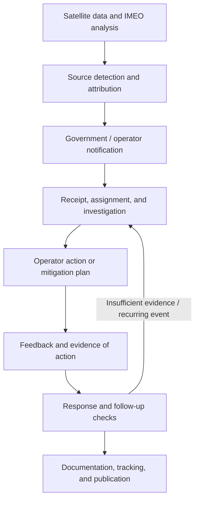

# MARS workflow and MethaneResponse's role

The implementation mapping was updated on 18 October 2026; primary-source pages were rechecked on that date. MARS is a service of the UNEP International Methane Emissions Observatory (IMEO).

## Official end-to-end workflow

UNEP divides it into four components:

1. **Detect & Attribute:** satellite detections are analyzed and attributed to sources using available information.
2. **Notify & Engage:** IMEO notifies governments and operators through applicable channels, then continues engagement.
3. **Stakeholders Take Action:** governments/operators investigate, determine a response, and report their actions.
4. **Track, Collaborate & Learn:** IMEO tracks progress, supports follow-up and learning, and publishes data.

Source: [UNEP — How MARS works](https://www.unep.org/en/what-we-do/energy/methane/how-mars-works).

For government response, the IEA–IMEO guide details five steps: receive/assign/classify a notification → notify the operator → obtain the operator's response → verify the response and follow-up → review and document the case. This is adaptable operational guidance, not a guarantee that every event will be resolved within the same timeframe.

Source: [IEA–IMEO, 4 May 2026](https://www.iea.org/reports/responding-to-satellite-notifications-from-the-methane-alert-and-response-system).

Feedback indicates a recorded response. The absence of a later plume is not proof of zero emissions: coverage, weather, and satellite-sensitivity limits still apply. Evidence of action and follow-up checks must be distinguished from administrative status.

Source: [IMEO — Eye on Methane FAQ](https://methanedata.unep.org/frequently-asked-questions).

## Product mapping

The following mapping is a MethaneResponse design decision for investigating public historical data, not a statement of official MARS integration.

| Investigation need | Product support | Limit |
|---|---|---|
| Identify source/event | Map, Cases, observations, snapshot provenance | Does not perform new satellite detection/attribution |
| Check notification | `operator_notified` claim, recipient, and reference date | Does not send notifications or prove delivery from a publisher flag |
| Check action | Event/period scope, action references, and follow-up | Does not perform or certify field repairs |
| Document an assessment | Rules baseline and private human assessment with rationale, references, and revisions | The model is optional; decisions must still state the method and evidence limits |
| Continue an investigation | Multiple work items per source/snapshot, evidence requests, next actions, and triage | Browser-note mode or an authorized single-writer shared queue; does not message operators or IMEO |
| Preserve version history | JSON bundle, digest, history, and report | Integrity does not establish physical truth |

Manual product workflow: **Cases → Overview / scope → Observations → Human assessment → Review → Report**. Document AI can optionally be selected for source-level claims.
